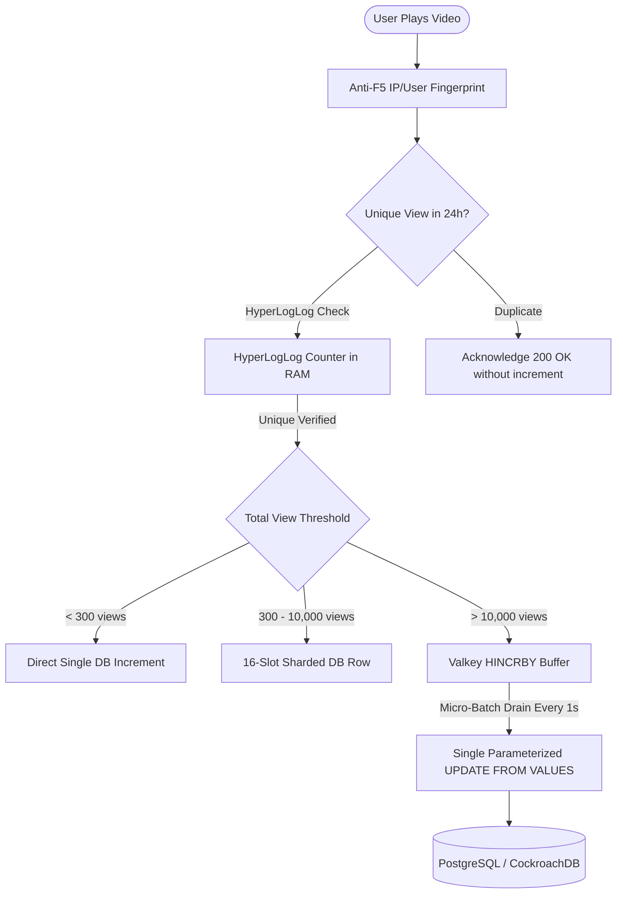
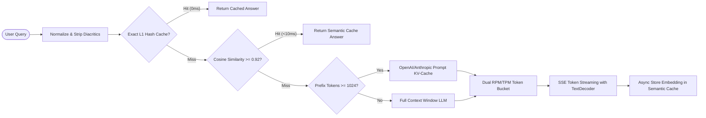
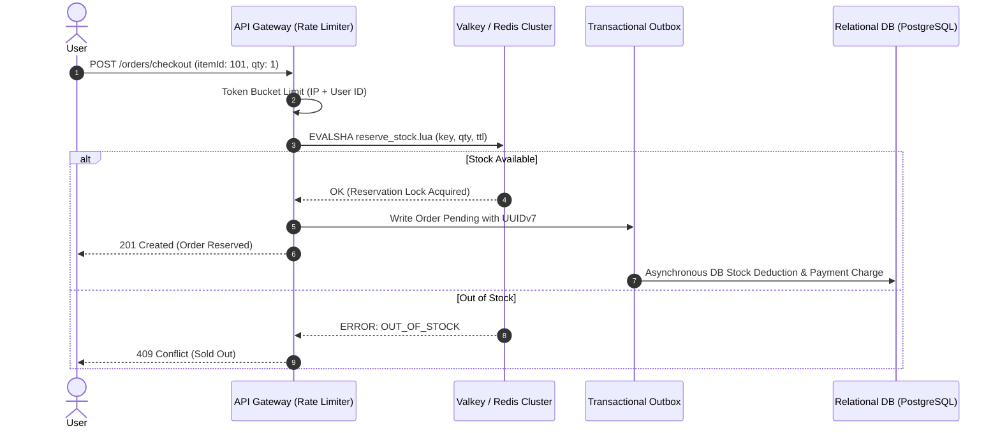
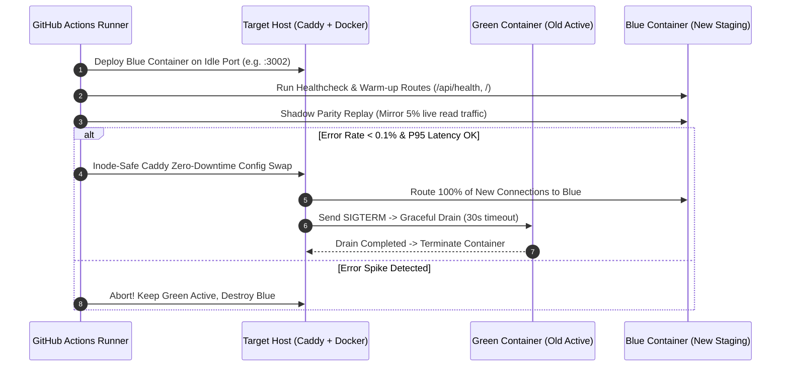

# Kido Architecture Blueprints (`kido-bag` · System Design Recipes)

> **Enterprise System Design Blueprints & Composite Architecture Recipes**  
> **Author:** [Dương Phúc Khánh (Duong Phuc Khanh · Kido · `khanhdp`)](https://khanhdp.com) — *Senior Software Engineer & Systems Architect*  
> **Ecosystem:** Composed from **39 Domain Combo Suites (125+ Functional Slices)** in [`kido-packages`](./packages/PACKAGES_REGISTRY.md)  
> **Philosophy:** *Shadcn for Distributed Systems* — Headless Slices (Primitives) $\to$ Domain Suites (Components) $\to$ Composite Blueprints (Blocks & Recipes).

---

## ⚡ The 3-Layer Taxonomy: How Kido Bag Works

```
┌────────────────────────────────────────────────────────────────────────┐
│  LAYER 3: COMPOSITE SYSTEM BLUEPRINTS (Architecture Blocks & Recipes)  │
│  e.g., YouTube View Counter · 5-Stage RAG Pipeline · Flash-Sale Engine │
└───────────────────────────────────┬────────────────────────────────────┘
                                    │ composes
┌───────────────────────────────────▼────────────────────────────────────┐
│  LAYER 2: DOMAIN COMBO SUITES (39 Cohesive Packages in @kido/*)        │
│  e.g., @kido/hot-counter · @kido/resilient-cache · @kido/async-sync    │
└───────────────────────────────────┬────────────────────────────────────┘
                                    │ contains
┌───────────────────────────────────▼────────────────────────────────────┐
│  LAYER 1: HEADLESS FUNCTIONAL SLICES (125+ Zero-Coupling Modules)     │
│  e.g., src/murmurhash · src/single-flight · src/token-bucket · src/hll │
└────────────────────────────────────────────────────────────────────────┘
```

---

## 🗺️ Master Blueprint Index

| # | Blueprint Name | Production Paradigm | Composed Kido Slices | Production Proof / Benchmark |
|---|---|---|---|---|
| **01** | **YouTube-Scale Video View Counter** | Adaptive Slotted Write + HLL Unique Dedupe + Anti-F5 | `@kido/hot-counter` (`youtube-view-engine`, `valkey-write-behind`, `slotted-counter`) + `@kido/traffic-attribution` (`hll-analytics`) | 100k views/sec $\to$ 99.9% DB write reduction; GonnaCrash Level 24 |
| **02** | **5-Stage Zero-Spam RAG & AI Copilot** | Semantic Vector Cache + Hybrid RRF + SSE Stream + RPM Guard + DLP/ACL Guard | `@kido/resilient-cache` (`semantic-cache`) + `@kido/ai-stream` (`sse-protocol`, `rpm-rate-guard`, `rag-security-guard`) + `@kido/anti-spam` (`dedupe`) | 80% LLM cost reduction; TTFT < 350ms; GonnaCrash W3 L02/03/05 |
| **03** | **Zero-Oversell Bounded Flash Sale** | Distributed Lua Decr + Token Bucket + Write-Behind | `@kido/resilient-cache` (`flashsale-engine`, `rate-limiter`) + `@kido/hot-counter` (`valkey-write-behind`) + `@kido/event-bus` | 50,000 req/sec; zero negative inventory; atomic rollback |
| **04** | **Zero-Cost 3-Tier Storage Lifecycle** | S3 WebCrypto SigV4 + R2 \$0 Cap + Imgproxy Transcoder | `@kido/storage-uploader` (`s3-r2`, `budget-guard`, `tiered-lifecycle`) | \$0 Cloudflare egress; auto-fallback to local SSD/HDD storage |
| **05** | **Twitter/X Hybrid Fanout Feed** | Push-Write + Pull-Read + O(N log K) Heap Cursor Merger | `@kido/hybrid-feed` (`hybrid-fanout-engine`, `k-way-cursor-merger`, `valkey-timeline-mixer`) | 20,600 req/s $\to$ 1,201 req/s; GonnaCrash Level 22 |
| **06** | **Zero-Downtime Blue-Green & Shadow Canary** | Caddy Zero-Gap Reload + Next.js Inode Guard + Shadow Parity | `@kido/zero-downtime-deploy` (`graceful-shutdown`, `caddy-reload`, `shadow-canary`) | 0 dropped HTTP/SSE connections; automated rollback on error spikes |
| **07** | **PostgreSQL Logical CDC Outbox & Cold Partition Archiver** | WAL Slot Replication + Timescale Hypertable + Gzip NDJSON | `@kido/async-sync` (`pg-cdc-stream`, `pg-partition-archiver`, `pg-replication`, `uuidv7`) | Sub-5ms event lag; zero-lock concurrent partition detaching |
| **08** | **Multi-Tenant SaaS Isolation & Surgical Snapshot** | Prisma RLS Filter + ABAC Guard + Demo Persona Sandbox | `@kido/tenant-guard` (`tenant-context`, `rls-query-filter`, `team-rbac`, `snapshot`, `sandbox`) | 100% data leakage prevention across tenants; instant demo sandbox reset |
| **09** | **Offline-First POS & SWR Confirmed Mutation Ledger** | UUIDv7 Conflict Resolver + SWR Service Worker + ITP Session | `@kido/async-sync` (`sync-engine`, `outbox-queue`) + `@kido/spa-version-guard` (`confirmed-ledger`, `session-vault`) | Zero data loss during network dropouts; client-side optimistic UI |
| **10** | **0ms TBT Growth Telemetry & OTLP Proxy** | Idle-Deferred Analytics + Redis HLL Unique Reach + Sentry Filter | `@kido/traffic-attribution` (`deferred-telemetry`, `otlp-vitals-proxy`, `utm`, `hll-analytics`) | 100/100 Lighthouse Performance; 0ms Total Blocking Time |
| **11** | **Double-Entry Financial Escrow & Multi-Currency Engine** | Immutable Debit/Credit Ledger + Micro-Decimal Crypto + VietQR | `@kido/wallet-ledger` (`ledger`, `crypto-reconcile`, `portfolio-nav`) + `@kido/payment-vietqr` + `@kido/payment-stripe` | Strict $\sum \text{Debit} = \sum \text{Credit}$ balance verification; anti-fraud clawback |
| **12** | **WMS Smart Warehouse Putaway & S-Shape 2-Opt Pick Wave** | GS1 Barcode Parser + FEFO Batch Expiry + TSP Warehouse Routing | `@kido/bom-inventory` (`wms-barcode`, `recipe-bom`, `inventory-alert`) + `@kido/geocoding-routing` (`haversine`) | 35% reduction in warehouse picker travel distance |

---

## 🛠️ Blueprint 01: YouTube-Scale Video View Counter

### Architecture
High-traffic video platforms (e.g. YouTube, TikTok) face a classic hotspot problem: a viral video receives 100,000 views per second, which would instantly incinerate a relational database with row-level write locks.



### Composed Slices
- `packages/hot-counter/src/youtube-view-engine.ts` (`YouTubeHybridViewEngine`, `HyperLogLogCounter`)
- `packages/hot-counter/src/valkey-write-behind.ts` (`ValkeyWriteBehindCounter`)
- `packages/hot-counter/src/slotted-counter.ts` (`SlottedCounter`)

### Usage Example
```typescript
import { YouTubeHybridViewEngine, HyperLogLogCounter } from "@kido/hot-counter/youtube-view-engine";
import { ValkeyWriteBehindCounter } from "@kido/hot-counter/valkey-write-behind";

// 1. Initialize Adaptive Engine
const hll = new HyperLogLogCounter();
const writeBehind = new ValkeyWriteBehindCounter({
  flushIntervalMs: 1000,
  maxBatchSize: 5000,
});

const viewEngine = new YouTubeHybridViewEngine({
  viralThreshold: 301, // Famous YouTube 301-view audit freeze
  hllDeduplicator: hll,
  async onFlushBatch(counts) {
    // Single SQL query updates all viral videos simultaneously
    await db.$executeRaw`
      UPDATE video_stats AS v
      SET views = v.views + batch.views
      FROM (SELECT * FROM UNNEST(${counts.videoIds}, ${counts.increments})) AS batch(video_id, views)
      WHERE v.id = batch.video_id;
    `;
  }
});
```

---

## 🤖 Blueprint 02: 5-Stage Zero-Spam RAG & AI Copilot Pipeline

### Architecture
Enterprise AI chat assistants often suffer from crippling API costs and slow responses when users repeatedly ask similar queries (e.g., "What is your refund policy?", "How do I reset my password?"). This blueprint provides a 5-tier filter pipeline.



### Composed Slices
- `packages/resilient-cache/src/semantic-cache/` (`SemanticVectorCache`, `cosineSimilarity`, `fuseRrfRankings`)
- `packages/ai-stream/src/sse-protocol.ts` (`SseStreamParser`, `formatSseDataFrame`)
- `packages/ai-stream/src/rpm-rate-guard/` (`DualRpmTpmTokenBucket`, `executeWithAiRateGuard`)
- `packages/ai-stream/src/rag-security-guard/` (`StreamingDlpRedactor`, `FailClosedScopeResolver`, `ProgressiveMessageEditThrottler`)

### Usage Example
```typescript
import { SemanticVectorCache } from "@kido/resilient-cache/semantic-cache";
import { DualRpmTpmTokenBucket, executeWithAiRateGuard } from "@kido/ai-stream/rpm-rate-guard";
import { formatSseDataFrame } from "@kido/ai-stream/sse-protocol";

const semanticCache = new SemanticVectorCache({ similarityThreshold: 0.92 });
const rateGuard = new DualRpmTpmTokenBucket({ maxRpm: 500, maxTpm: 100_000 });

export async function handleUserPrompt(userPrompt: string, embedding: number[]) {
  // 1. Check Semantic Cache (<10ms)
  const cached = semanticCache.findNearest(embedding);
  if (cached) return { source: "semantic-cache", text: cached.response };

  // 2. Guard against Provider 429 Rate Spikes
  return await executeWithAiRateGuard(rateGuard, async () => {
    const stream = await callLLMProvider(userPrompt);
    // 3. Save to cache asynchronously once stream completes
    stream.onComplete((fullText) => semanticCache.set(userPrompt, embedding, fullText));
    return stream;
  });
}
```

---

## ⚡ Blueprint 03: Zero-Oversell Bounded Flash Sale Engine

### Architecture
High-traffic flash sales (e.g. 100 units of iPhone at 90% discount) must guarantee **atomic reservation** without table lock escalation or negative stock anomalies.



### Composed Slices
- `packages/resilient-cache/src/flashsale-engine/` (`FlashSaleEngine`, `RESERVE_STOCK_LUA`, `ROLLBACK_STOCK_LUA`)
- `packages/resilient-cache/src/rate-limiter/` (`TokenBucketLimiter`, `SLIDING_WINDOW_LUA`)
- `packages/event-bus/src/index.ts` (`DomainEventBus`, `exponentialBackoffWithJitter`)

---

## ☁️ Blueprint 04: Zero-Cost 3-Tier Storage Lifecycle

### Architecture
Media assets uploaded to cloud storage can rack up massive bills. This blueprint orchestrates Cloudflare R2 (\$0 egress), local NVMe SSD (fast access), and local HDD/Cold storage (archival) with dynamic imgproxy transcoding.

```mermaid
flowchart TD
    Client([Browser / Mobile Upload]) --> Presign[Presigned SigV4 Generator]
    Presign --> R2Budget{R2 Under 10GB/mo Free Tier?}
    R2Budget -- Yes --> DirectR2[Direct Upload to Cloudflare R2]
    R2Budget -- Free Cap Exceeded --> LocalSSD[Direct Upload to VPS SSD]
    
    DirectR2 & LocalSSD --> AssetLifecycle[Lifecycle Engine (30-Day Age Check)]
    AssetLifecycle --> Hot{Accessed in last 7 days?}
    Hot -- Yes --> CDN[Served via Cloudflare CDN]
    Hot -- No --> ColdHDD[Moved to Cold HDD / Compressed WebP via imgproxy]
```

### Composed Slices
- `packages/storage-uploader/src/adapters/s3-r2.ts` (`R2Presigner`, `generatePresignedPutUrl`)
- `packages/storage-uploader/src/budget-guard/` (`evaluateStorageBudgetGuard`, `checkCloudflareR2Budget`)
- `packages/storage-uploader/src/tiered-lifecycle/` (`resolveUploadTargetTier`, `buildImgproxyColdTranscodeUrl`)

---

## 🔄 Blueprint 05: Twitter/X Hybrid Fanout Feed Engine

### Architecture
Solving the classic celebrity problem in timeline feeds: pushing new tweets to millions of followers creates write amplification, while pulling from thousands of followed users creates read bottlenecks.

```mermaid
flowchart TD
    Author([Author Posts Tweet]) --> FanoutCheck{Follower Count >= 25,000?}
    
    FanoutCheck -- "Normal User (<25k)" --> PushWrite[Push Write: Fanout to All Follower Inboxes]
    PushWrite --> ValkeyInboxes[Valkey Capped Sorted Sets (Max 800 items)]
    
    FanoutCheck -- "Celebrity (>=25k)" --> PullBypass[Bypass Fanout: Write to Celebrity Outbox Only]
    
    Reader([Follower Opens Feed]) --> ReadFeed[Feed Reader Engine]
    ReadFeed --> ValkeyInboxes
    ReadFeed --> CelebrityOutboxes[Fetch Followed Celebrities' Outboxes]
    
    ValkeyInboxes & CelebrityOutboxes --> KWayMerge[K-Way Binary Max-Heap Cursor Merger]
    KWayMerge --> UnifiedTimeline([Unified Timeline in O(N log K)])
```

### Composed Slices
- `packages/hybrid-feed/src/hybrid-fanout-engine.ts` (`HybridFanoutEngine`)
- `packages/hybrid-feed/src/k-way-cursor-merger.ts` (`kWayMergeFeeds`, `BinaryMaxHeap`, `encodeTimelineCursor`)
- `packages/hybrid-feed/src/valkey-timeline-mixer.ts` (`ValkeyTimelineMixer`, `LUA_ZADD_CAPPED_TIMELINE`)

---

## 🚀 Blueprint 06: Zero-Downtime Blue-Green & Shadow Canary Gate

### Architecture
Ensures zero dropped user requests and zero Next.js Server Action 404s during continuous deployments on single VPS instances or container clusters.



### Composed Slices
- `packages/zero-downtime-deploy/src/graceful-shutdown.ts` (`setupGracefulShutdown`, `performHealthCheck`)
- `packages/zero-downtime-deploy/src/caddy-reload/` (`generateCaddyZeroDowntimeSnippet`, `buildInodeSafeCaddyReloadCmd`)
- `packages/zero-downtime-deploy/src/shadow-canary/` (`runShadowParityCheck`, `buildShadowAndCanaryBashGate`)

---

## 📦 How to Use These Blueprints

### Mode 1: Surgical Extraction into an External Project (Recommended)
AI Agents or developers copy only the required slices into `src/lib/` or `src/modules/`:
```bash
# Example: Extracting Blueprint 01 slices into your backend project
mkdir -p src/lib/hot-counter
cp $KIDO_PACKAGES_DIR/packages/hot-counter/src/youtube-view-engine.ts src/lib/hot-counter/
cp $KIDO_PACKAGES_DIR/packages/hot-counter/src/valkey-write-behind.ts src/lib/hot-counter/
```

### Mode 2: Monorepo Package Imports
Inside the `kido-packages` or linked workspace:
```typescript
import { YouTubeHybridViewEngine } from "@kido/hot-counter/youtube-view-engine";
import { SemanticVectorCache } from "@kido/resilient-cache/semantic-cache";
import { HybridFanoutEngine } from "@kido/hybrid-feed/hybrid-fanout-engine";
```
