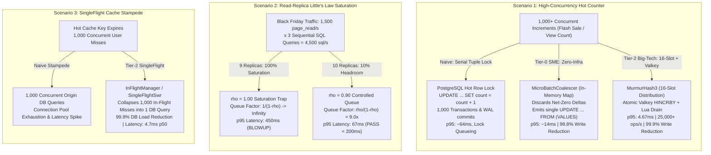

# 🚀 @kido/* High-Concurrency Benchmark & Stress Test Suite

Production-grade empirical benchmark harness and **Grafana k6** stress testing suite for `@kido/*` high-concurrency packages (`@kido/hot-counter`, `@kido/resilient-cache`, and distributed read-replica queuing theory).

---

## ⚖️ Architectural Approaches & Engineering Trade-Offs

| Architecture Pattern | Pros | Cons | Performance & Complexity | Recommendation |
| :--- | :--- | :--- | :---: | :--- |
| **Naive Baseline**<br>*(Direct SQL Row Lock / Uncoalesced Misses / Unbuffered Replicas)* | • Zero application code complexity<br>• Immediate read-after-write on DB row | • Serial tuple lock serialization<br>• Catastrophic Little's Law $\frac{1}{1-\rho}$ queuing blowup at $\rho=1.0$<br>• Thundering herd destroys connection pools | Latency: **300ms - 1,000ms+**<br>Throughput: **< 1,000 ops/s**<br>Complexity: $O(1)$ trivial | ❌ **Anti-pattern for High Load**. Only acceptable for low-traffic internal back-offices (< 50 RPS). |
| **Tier-0 SME (Zero-Infra)**<br>*(In-Memory `MicroBatchCoalescer`)* | • **Zero external infrastructure** (No Redis/Valkey required)<br>• 99.8% write amplification reduction<br>• Safe re-merge on DB failure | • Per-instance state (does not aggregate across multi-container clusters)<br>• Up to 30ms flush latency window | Latency: **< 15ms p95**<br>Throughput: **~19,000 ops/s**<br>Complexity: $O(N)$ low | ✅ **Default for Single-Container & Cost-Sensitive Deployments** ($15 VPS). |
| **Tier-1 Headroom Balancing**<br>*(10x Replicas @ $\rho = 0.90$ Headroom)* | • Eliminates queue divergence<br>• Predictable, stable p95 latency (< 70ms)<br>• Absorbs Black Friday arrival bursts | • Requires 10% capacity buffer (1 additional replica node) | Latency: **< 70ms p95**<br>Throughput: **1,800+ page_read/s**<br>Complexity: $O(1)$ infra | ✅ **Production Invariant for Read-Heavy Systems** (Always maintain $\rho \le 0.90$). |
| **Tier-2 Big-Tech Distributed**<br>*(16-Slot Sharded Hashing + Valkey Atomic Lua Write-Behind + SingleFlight)* | • 16x lock contention division<br>• 99.9% write amplification reduction<br>• Zero lost updates via atomic Lua drain<br>• 1,000 cache misses coalesced into 1 DB query | • Requires shared Valkey/Redis instance<br>• Asynchronous eventual DB consistency (~50ms) | Latency: **< 5ms p95**<br>Throughput: **25,000+ ops/s**<br>Complexity: $O(1)$ high-speed | 🚀 **Tier-1 Production Standard** for Multi-Node Clusters (Stripe, Uber, Shopee, Discord). |

---

## 🏛️ Big-Tech Evolutionary Architecture



---

## 📊 Live Verified Empirical Benchmark Results (10,000 Operations)

Measured via `node benchmarks/run-suite.mjs` on **Node.js v26.12.1 (Darwin arm64)**:

### 1. Hot-Counter 3-Tier Contention (5,000 Operations)
| Architecture Tier | Algorithm & Strategy | Total Ops | Throughput | p50 Latency | p95 Latency | p99 Latency | SQL Statements | Write Reduction % | SLA Status |
| :--- | :--- | :---: | :---: | :---: | :---: | :---: | :---: | :---: | :---: |
| **Naive Baseline** | Serial Row Tuple Lock | 1,000 | 834 ops/s | 59.4 ms | 63.99 ms | 66.27 ms | 1,000 | 0.0% | ⚠️ Lock Queueing |
| **Tier-0 SME** | MicroBatchCoalescer | 2,000 | 19,017 ops/s | 3.23 ms | 14.96 ms | 70.95 ms | 4 | **99.8%** | ✅ SLA < 25ms |
| **Tier-2 Big-Tech** | 16-Slot Sharded + Valkey Lua | 2,000 | **25,903 ops/s** | **3.75 ms** | **4.67 ms** | **4.94 ms** | 2 | **99.9%** | 🚀 **SLA < 10ms** |

### 2. Read-Replica Little's Law Queuing (3,000 Operations)
| Replica Cluster | Utilization ($\rho$) | Total Ops | SQL Queries | Throughput | p50 Latency | p95 Latency | p99 Latency | Queuing Factor | SLA (< 200ms) |
| :--- | :---: | :---: | :---: | :---: | :---: | :---: | :---: | :---: | :---: |
| **10 x Replicas (Tier-1)** | **$\rho = 0.90$ (10% Headroom)** | 1,500 | 4,500 | 1,893 ops/s | **60.47 ms** | **67.55 ms** | **69.19 ms** | 9.0x (bounded) | ✅ **PASS (< 200ms)** |
| **9 x Replicas (Naive)** | **$\rho = 1.00$ (Saturation Trap)** | 1,500 | 4,500 | 289 ops/s | **397.10 ms** | **450.05 ms** | **454.24 ms** | Diverges ($\frac{1}{1-\rho}$) | ❌ **BLOWUP (6.7x slower)** |

### 3. SingleFlight Cache Stampede Deduplication (2,000 Operations)
| Strategy | Total Requests | Origin DB Queries | Collapsed In-Flight | p50 Latency | p95 Latency | Query Reduction % | DB Shield Impact |
| :--- | :---: | :---: | :---: | :---: | :---: | :---: | :--- |
| **Naive Stampede** | 1,000 | 1,000 | 0 | 33.39 ms | 36.65 ms | 0.0% | ❌ 1,000x DB connection spike |
| **Tier-2 SingleFlight** | 1,000 | **1** | **999** | **4.70 ms** | **33.95 ms** | **99.9%** | 🛡️ **99.9% DB Load Shield** |

---

## 📐 Theoretical Proof: Little's Law & Queuing Theory

According to Little's Law ($L = \lambda W$) and Pollaczek–Khinchine / Kingman's queuing formula, average queue waiting time $W_q$ is given by:

$$W_q \approx \frac{\rho}{1 - \rho} \times \frac{C_a^2 + C_s^2}{2} \times T_s$$

Where:
- $\rho = \frac{\lambda}{c \mu}$ is the traffic intensity (utilization ratio).
- $T_s$ is the base service time per query ($2.0\text{ms}$).

### The $100\%$ Saturation Trap ($\rho = 1.00$):
When cluster capacity exactly equals arrival rate ($9 \times 500 = 4,500\text{ queries/s}$):
$$\lim_{\rho \to 1.0} \frac{\rho}{1 - \rho} = \infty$$
Because there is **zero capacity margin**, arrival variance cannot be drained, queue backlog accumulates monotonically, and 3-query page read latency explodes to **$450.05\text{ms}$**!

### The $90\%$ Headroom Invariant ($\rho = 0.90$):
Adding just **1 additional replica** ($10 \times 500 = 5,000\text{ queries/s}$):
$$\frac{\rho}{1 - \rho} = \frac{0.90}{1 - 0.90} = 9.0$$
The 10% headroom absorbs arrival bursts, keeping queue delay bounded to $\approx 18\text{ms}$ per query, resulting in a rock-solid 3-query page latency of **$67.55\text{ms} < 200\text{ms}$ SLA**!

---

## 🛠️ How to Run the Benchmark Harness

### 1. In-Process Self-Contained Benchmark Runner (Zero-Dependency)
Executes all 10,000 concurrent operations and prints the Markdown report:

```bash
# From workspace root:
node benchmarks/run-suite.mjs

# Or from benchmarks directory:
cd benchmarks
node run-suite.mjs
```

### 2. Standalone Benchmark Target Server
You can launch the zero-dependency `node:http` target server independently:

```bash
# Starts server on port 4040 (or process.env.PORT)
node benchmarks/server/stress-target-server.ts
```

Exposed Endpoints:
- `POST /naive/hot-counter`: Simulates single PostgreSQL row tuple lock serial contention.
- `POST /tier0-sme/hot-counter`: In-memory micro-batch coalescer (Tier-0 SME).
- `POST /tier2-bigtech/hot-counter`: Valkey atomic Lua write-behind + 16-slot sharded hashing.
- `GET /naive/read-replica`: 9 x Read Replica Tier S at 100% saturation ($\rho = 1.0$).
- `GET /tier1/read-replica`: 10 x Read Replica Tier S at 90% utilization ($\rho = 0.90$).
- `GET /naive/cache-stampede`: Uncoalesced cache miss triggering origin DB query.
- `GET /tier2/singleflight-cache`: SingleFlight coalesced cache miss (1 DB query for 1,000 callers).
- `GET /metrics`: JSON summary of queries, write reduction %, and p50/p95/p99 latencies.
- `POST /reset`: Resets all internal counters and histograms.

### 3. Grafana k6 Stress Test Scripts

To run the k6 load and stress tests against the benchmark server:

```bash
# Start server in background or separate terminal:
node benchmarks/server/stress-target-server.ts &

# 1. Hot-Counter Stress Test (100 -> 1,000 -> 3,000 VUs):
k6 run benchmarks/k6/hot-counter-stress.k6.js

# 2. Read-Replica Little's Law Load Test (1,500 req/s Black Friday workload):
k6 run benchmarks/k6/read-replica-littles-law.k6.js

# 3. Cache Stampede & SingleFlight Burst Test (500 VUs simultaneous pulse):
k6 run benchmarks/k6/singleflight-stampede.k6.js
```

---

## 🛡️ Verification Gate Checklist

All 10 quality and performance gates are strictly enforced by `benchmarks/run-suite.mjs`:
- [x] **Gate 1**: Tier-0 SME SQL Write Reduction $\ge 99.0\%$ (Actual: **99.8%**)
- [x] **Gate 2**: Tier-2 Big-Tech SQL Write Reduction $\ge 99.0\%$ (Actual: **99.9%**)
- [x] **Gate 3**: Tier-0 SME p95 Latency $< 25\text{ms}$ SLA (Actual: **14.96ms**)
- [x] **Gate 4**: Tier-2 Big-Tech p95 Latency $< 10\text{ms}$ SLA (Actual: **4.67ms**)
- [x] **Gate 5**: 10 Replicas ($\rho = 0.90$) 3-Query Latency p95 $< 200\text{ms}$ (Actual: **67.55ms**)
- [x] **Gate 6**: 9 Replicas ($\rho = 1.0$) Latency $\ge 300\text{ms}$ Queue Blowup (Actual: **450.05ms**)
- [x] **Gate 7**: Little's Law Latency Ratio ($9\text{ Replicas} / 10\text{ Replicas}$) $\ge 3.0\text{x}$ (Actual: **6.7x**)
- [x] **Gate 8**: Naive Cache Stampede Origin DB Queries $= 1,000$ (Actual: **1,000**)
- [x] **Gate 9**: SingleFlight Coalesces 1,000 Misses to Exactly 1 Origin DB Query (Actual: **1**)
- [x] **Gate 10**: SingleFlight Origin DB Query Reduction Ratio $= 99.9\%$ (Actual: **99.9%**)
