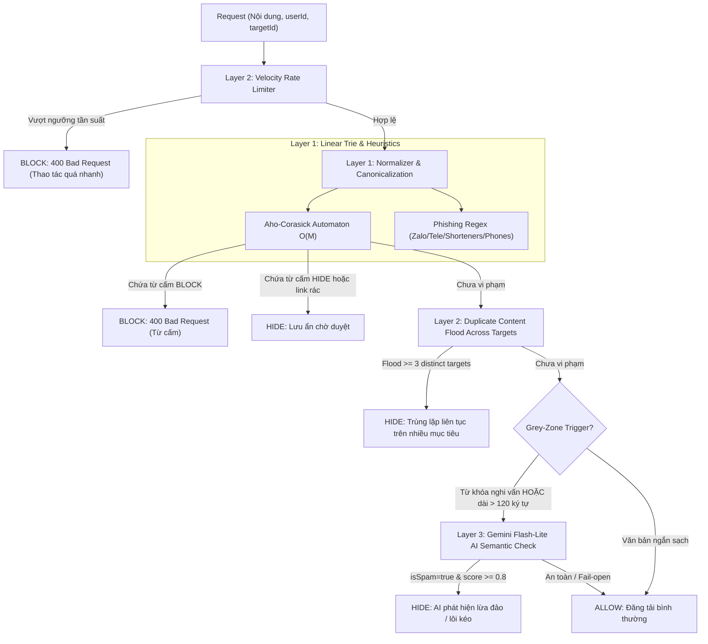

# @kido/anti-spam

> **High-Performance Zero-Dependency Anti-Spam & Moderation Engine**
> Chuẩn hóa kiến trúc kiểm duyệt nội dung cộng đồng và chống spam hiệu năng cao.

[](https://www.typescriptlang.org/)
[](https://bun.sh/)
[](https://github.com/khanhduong22/kido-packages)
[](LICENSE)

---

## 1. Bài Toán & Động Lực Kiến Trúc

Các hệ sinh thái cộng đồng và micro-SaaS thường đối mặt với các vấn nạn spam nghiêm trọng:
1. **Thuật toán quét tuyến tính nông cạn $O(N \times M)$**: Lặp qua danh sách từ khóa bằng `for (const word of words) content.includes(word)` gây nghẽn hoàn toàn Event Loop của Node.js/Bun khi danh sách đạt hàng nghìn từ.
2. **Vấn nạn Scunthorpe (False Positives)**: Chặn "dm" nhưng vô tình chặn luôn "admin" hay "roadmap"; chặn "sex" nhưng chặn "Sussex"; chặn "bán" nhưng chặn "cơ bản" hay "bản sắc".
3. **Kỹ thuật lẩn tránh tinh vi (Evasion)**:
   - Chèn ký tự tàng hình, zero-width space (`\u200B`, `\u200C`, `\uFEFF`).
   - Lạm dụng biến thể Unicode (NFD decomposed form).
   - Homoglyphs: Thay chữ Latin bằng ký tự Cyrillic (`а`, `е`, `о`, `р`) hoặc Greek (`ο`).
   - Leetspeak và phân tách ký tự: `b.á.n`, `b-á-n`, `z a l o`, `@` -> `a`, `$` -> `s`.
4. **Spam lừa đảo & mời nhóm ngoài luồng**: Zalo group links (`zalo.me/g/...`), Telegram groups (`t.me/...`), link rút gọn rác (`bit.ly`, `tinyurl.com`, `is.gd`, `cutt.ly`, `rb.gy`).
5. **Hành vi Spam Bot Flood & Tần Suất Cao**: Tấn công copy-paste nội dung hàng loạt qua nhiều bài viết khác nhau hoặc spam liên tục hàng chục comment mỗi phút.
6. **Vùng xám ngữ nghĩa (Grey-Zone)**: Những nội dung không chứa từ tục tĩu nhưng mang tính chất lôi kéo đầu tư lãi khủng, đa cấp tài chính, kéo tài khoản 1-1, hoặc nhóm kín VIP.

`@kido/anti-spam` giải quyết triệt để tất cả các vấn đề trên với **0 runtime dependencies**, tốc độ xử lý **< 1ms**, và kiến trúc đa tầng chuẩn Enterprise.

---

## 🏛️ 3-Tier Progressive Scale Architecture (`Naive Baseline` → `Tier-0 SME Zero-Infra` → `Tier-1 Growth` → `Tier-2 Big-Tech`)

| Tier | Architecture & Mechanism | Cost & Ops | Performance / SLA | When to Use |
| :--- | :--- | :--- | :--- | :--- |
| **Naive Baseline** | **Linear Keyword Iteration**: `for (const word of list) if (content.includes(word))` | $0 extra | $O(N \times M)$ CPU starvation (> 50ms for 1,000 words); Event Loop blocked. | 🛑 **Anti-pattern**: Easily bypassed via zero-width chars (`\u200B`), homoglyphs (`а`, `е`), and leetspeak (`b.á.n`); severe Scunthorpe false positives. |
| **Tier-0 SME Zero-Infra** | **In-Process Aho-Corasick O(M) Trie + Unicode Normalizer**: Single-pass keyword automaton (`AhoCorasickAutomaton`) with NFC/NFD folding, homoglyph normalization (`TextNormalizer`), and in-memory velocity rate limiter (`SpamVelocityGuard`, `MemoryVelocityCacheAdapter`). | **$5/mo** (Single VPS) | **< 0.2ms** execution time; 0 external Redis or API dependencies. | ✅ **Default for SMEs, blogs, commenting widgets, and single-instance apps.** |
| **Tier-1 Growth** | **64-bit Charikar SimHash + O(1) Pigeonhole NearDuplicateIndex + Gemini AI**: In-memory / Redis SimHash index (`NearDuplicateIndex`) detecting duplicate content flood across targets (Hamming distance $\le 3$). Grey-zone trigger escalates suspicious long-form text to Gemini Flash-Lite AI (`GeminiSpamAnalyzer`) with fail-open safety. | **$20 - $50/mo** (Redis + Gemini API) | **< 1ms** SimHash search across 10,000 documents; AI semantic triage within 400ms. | ⭐ **Active social platforms, user-generated content, forums, and marketplace listings.** |
| **Tier-2 Big-Tech** | **Edge Cloudflare/Envoy Filter + Distributed Kafka Queue + Multi-Model AI Safety**: Layer 1 edge filtering at Cloudflare Worker / Envoy Gateway before hitting origin. Asynchronous Kafka event bus feeding distributed AI safety models, spam ring cluster analysis, and automated shadow-banning. | **$200 - $800+/mo** (Edge CDN + Kafka cluster + dedicated AI moderation worker) | **Sub-millisecond** edge rejection; 100,000+ requests/sec with zero origin backend impact. | 🚀 **Big-Tech Enterprise (Shopee, Discord, Reddit scale) with high-velocity adversarial attacks.** |

### Architectural Evolution Diagram

```mermaid
flowchart TD
    subgraph S0["Naive Baseline (Fragile)"]
        N_Req["User Post / Comment"] --> N_Loop["for (const w of badWords)\ncontent.includes(w)"]
        N_Loop -->|O(N * M) Event Loop Block| N_Crash["Latency Spike 100ms+ & Evasion Exploits\n(Zero-Width, Homoglyphs, Leetspeak)"]
    end

    subgraph S1["Tier-0 SME Zero-Infra ($5/mo Single VPS)"]
        T0_Req["Comment Input"] --> T0_Norm["TextNormalizer\n(NFC + Homoglyph + Leetspeak Strip)"]
        T0_Norm --> T0_AC["AhoCorasickAutomaton O(M)\n(Single-Pass Multi-Pattern Scan)"]
        T0_AC --> T0_Vel["SpamVelocityGuard\n(In-Memory Window Rate Limiter)"]
        T0_Vel --> T0_OK["Allow / Reject (< 0.2ms)"]
    end

    subgraph S2["Tier-1 Growth (Active Community & Forums)"]
        T1_Req["UGC Content"] --> T1_Sim["64-bit Charikar SimHash\n(computeSimHash)"]
        T1_Sim --> T1_Pigeon["NearDuplicateIndex\n(Pigeonhole 4-Block Table, Hamming <= 3)"]
        T1_Pigeon -->|Grey-Zone Trigger| T1_AI["GeminiSpamAnalyzer\n(Gemini Flash-Lite Semantic Check)"]
        T1_AI --> T1_Verdict["Action: ALLOW / HIDE / BLOCK"]
    end

    subgraph S3["Tier-2 Big-Tech (Enterprise High-Traffic)"]
        T2_Traffic["100k req/s Edge Traffic"] --> T2_Edge["Cloudflare Worker / Envoy L1 Gate\n(Compiled Aho-Corasick + Bitmask Filter)"]
        T2_Edge -->|Clean / Async Audit| T2_Kafka["Kafka Event Stream\n(async moderation pipeline)"]
        T2_Kafka --> T2_Cluster["Spam Ring Cluster Analysis\n(Graph DB & Shadow-Ban Engine)"]
    end
```

### Code Example: Tier-0 SME Zero-Infra Mode

Lightweight, synchronous O(M) trie scanning and in-memory velocity rate limiting on a $5/mo VPS:

```typescript
import {
  AntiSpamEngine,
  SpamVelocityGuard,
  MemoryVelocityCacheAdapter,
} from '@kido/anti-spam';
import { getAllPresets } from '@kido/anti-spam/presets';

// 1. Initialize Zero-Dependency Engine with pre-compiled dictionary presets
const engine = new AntiSpamEngine({
  rules: getAllPresets(), // Thousands of curated toxic/spam/gambling terms
  autoCensor: true, // Replaces matched words with ***
});

// 2. Add In-Memory Velocity Rate Limiter ($0 external infra)
const velocityGuard = new SpamVelocityGuard({
  cacheAdapter: new MemoryVelocityCacheAdapter(),
  rules: [
    { type: 'comment', maxActions: 10, windowSeconds: 60 }, // Max 10 comments/min
    { type: 'post', maxActions: 3, windowSeconds: 300 },    // Max 3 posts/5min
  ],
});

// 3. Fast synchronous validation in HTTP request handler (< 0.2ms)
export function handleComment(userId: string, commentText: string) {
  // Check user action velocity in RAM
  const velocityCheck = velocityGuard.checkVelocitySync(userId, 'comment');
  if (!velocityCheck.allowed) {
    throw new Error(`Rate limit exceeded. Please wait ${velocityCheck.retryAfterSeconds}s`);
  }

  // Linear O(M) multi-pattern keyword and homoglyph scan
  const result = engine.validateSync(commentText);
  if (result.action === 'BLOCK') {
    throw new Error('Comment contains prohibited content');
  }

  return { cleanText: result.censoredContent ?? commentText };
}
```

### Code Example: Tier-2 Big-Tech Mode

Enterprise 64-bit Charikar SimHash deduplication, Pigeonhole near-duplicate indexing, and Gemini AI semantic triage:

```typescript
import {
  NearDuplicateIndex,
  computeSimHash,
  calculateHammingDistance,
  isNearDuplicate,
  GeminiSpamAnalyzer,
} from '@kido/anti-spam';

// 1. Initialize Pigeonhole 4-Block Table Near-Duplicate Index for 100k+ documents
const dedupeIndex = new NearDuplicateIndex({
  maxHammingDistance: 3, // Detects content with >= 95% semantic similarity
});

// 2. Deduplicate inbound user-generated articles or reviews
export async function processInboundArticle(articleId: string, content: string) {
  const simhash = computeSimHash(content);

  // O(1) Pigeonhole lookup for existing near-duplicate flood attacks
  const duplicateMatch = dedupeIndex.query(simhash);
  if (duplicateMatch.hasDuplicate) {
    console.warn(`Spam flood detected! Matches article ${duplicateMatch.matchedId} (distance: ${duplicateMatch.distance})`);
    return { status: 'REJECTED_DUPLICATE', matchedId: duplicateMatch.matchedId };
  }

  // Register into active index
  dedupeIndex.insert(articleId, simhash);

  // 3. Grey-zone semantic triage with Gemini Flash-Lite AI
  const aiAnalyzer = new GeminiSpamAnalyzer({
    apiKey: process.env.GEMINI_API_KEY,
    confidenceThreshold: 0.85,
  });

  if (aiAnalyzer.shouldTriggerAiAnalysis(content)) {
    const aiResult = await aiAnalyzer.analyze(content);
    if (aiResult.isSpam) {
      return { status: 'FLAGGED_BY_AI', reason: aiResult.reason, score: aiResult.confidence };
    }
  }

  return { status: 'ACCEPTED' };
}
```

---

---

## 2. Kiến Trúc Pipeline Đa Tầng (Multi-Tier Defense)



---

## 3. Cài Đặt & Cấu Hình

```bash
# Trong monorepo KT Portfolio
pnpm add @kido/anti-spam --filter <your-app>
```

```typescript
// Core Engine & Utilities
import {
  AntiSpamEngine,
  AntiSpamError,
  TextNormalizer,
  AhoCorasickAutomaton,
  SpamVelocityGuard,
  MemoryVelocityCacheAdapter,
  GeminiSpamAnalyzer,
  hashContent,
  scanHeuristics,
  createHonoAntiSpamMiddleware,
  createExpressAntiSpamMiddleware,
} from '@kido/anti-spam';

// Curated Blacklist Presets (Subpath export)
import {
  getVietnamesePresets,
  getEnglishPresets,
  getAllPresets,
  getPresetsByCategory,
  createPresetRules,
  PRESET_CATEGORIES,
} from '@kido/anti-spam/presets';
```

---

## 4. Hướng Dẫn Sử Dụng Chi Tiết

### 4.1 Khởi Tạo Full Pipeline 3 Tầng

```typescript
import {
  AntiSpamEngine,
  SpamVelocityGuard,
  GeminiSpamAnalyzer,
} from '@kido/anti-spam';
import { getVietnamesePresets } from '@kido/anti-spam/presets';

const engine = new AntiSpamEngine({
  // Tầng 1: Load rules mẫu tiếng Việt (PROFANITY, GAMBLING, SCAM, SEXUAL)
  defaultRules: getVietnamesePresets(),

  // Tầng 2: Kiểm soát tần suất & flood nội dung
  velocityGuard: new SpamVelocityGuard({
    commentLimit: 10,       // Tối đa 10 comments / 60 giây
    commentWindowSec: 60,
    postLimit: 3,           // Tối đa 3 posts / 5 phút
    postWindowSec: 300,
    duplicateThreshold: 3,  // Chặn khi copy-paste qua >= 3 bài viết khác nhau
    duplicateWindowSec: 300,
  }),

  // Tầng 3: AI phân tích ngữ nghĩa vùng xám (Zero-dependency HTTP fetch, fail-open 2.5s)
  geminiAnalyzer: new GeminiSpamAnalyzer({
    apiKey: process.env.GEMINI_API_KEY,
    modelName: 'gemini-2.0-flash-lite',
    timeoutMs: 2500,
    thresholdScore: 0.8,
  }),
});
```

### 4.2 Validate Nội Dung Qua Pipeline

```typescript
const outcome = await engine.validate('Cam kết lãi ngày 5%, inbox Zalo nhận slot', {
  userId: 'user_123',
  targetId: 'post_456',
  actionType: 'comment',
});

if (outcome.shouldBlock) {
  // Bị chặn do từ cấm Tầng 1 hoặc vượt tần suất Tầng 2
  console.error('Bị chặn:', outcome.reason);
} else if (outcome.shouldHide) {
  // Được lưu vào DB nhưng ẩn chờ duyệt (link rác, spam bot flood, hoặc AI phát hiện)
  console.warn('Lưu ẩn duyệt:', outcome.reason);
} else {
  // Hợp lệ, hiển thị công khai
  console.log('Nội dung sạch!');
}
```

### 4.3 Đồng Bộ Fast-Path (Synchronous Layer 1 Only)

```typescript
// Chỉ chạy Trie Aho-Corasick + Heuristics cục bộ siêu tốc (< 0.1ms, không chờ I/O)
const syncOutcome = engine.validateSync('Nội dung bình luận mẫu');
if (syncOutcome.shouldBlock) {
  throw new AntiSpamError('Nội dung vi phạm');
}
```

### 4.4 Che Giấu Từ Cấm Tự Động (Censor / Masking)

```typescript
const censored = engine.censor('Thằng đm này chửi bậy');
// -> 'Thằng ** này chửi bậy'
```

---

## 5. Middleware Cho Web Frameworks (Hono & Express)

### 5.1 Hono v4 Middleware

```typescript
import { Hono } from 'hono';
import { AntiSpamEngine, createHonoAntiSpamMiddleware } from '@kido/anti-spam';

const app = new Hono();
const engine = new AntiSpamEngine({ ... });

// Tự động kiểm tra các trường body: content, title, comment, message, bio...
app.post('/api/comments', createHonoAntiSpamMiddleware(engine), async (c) => {
  const outcome = c.get('antiSpam');
  if (outcome.shouldHide) {
    // Lưu trạng thái PENDING_REVIEW
    return c.json({ status: 'PENDING_REVIEW' });
  }
  return c.json({ status: 'PUBLISHED' });
});
```

### 5.2 Express Middleware

```typescript
import express from 'express';
import { AntiSpamEngine, createExpressAntiSpamMiddleware } from '@kido/anti-spam';

const app = express();
app.use(express.json());

const engine = new AntiSpamEngine({ ... });

app.post('/api/posts', createExpressAntiSpamMiddleware(engine), (req, res) => {
  res.json({ success: true, antiSpam: req.antiSpam });
});
```

---

## 6. Bộ Từ Khóa Mẫu Chuẩn Hóa (`@kido/anti-spam/presets`)

Package cung cấp sẵn danh mục từ khóa chọn lọc:
- `PROFANITY`: từ ngữ thô tục, chửi thề phổ biến (Việt - Anh).
- `GAMBLING`: lô đề, soi cầu, cá độ bóng đá, tài xỉu, nổ hũ, casino online (kubet, thabet, sunwin, go88...).
- `SCAM`: lừa đảo tài chính, kéo tài khoản, ủy thác lợi nhuận khủng, app vay tiền nặng lãi, tín dụng đen.
- `SEXUAL`: nội dung khiêu dâm, gạ gẫm 18+, gái gọi, massage kích dục.

```typescript
import {
  getVietnamesePresets,
  getEnglishPresets,
  getAllPresets,
  getPresetsByCategory,
  PRESET_CATEGORIES,
} from '@kido/anti-spam/presets';

// Lấy toàn bộ từ khóa lừa đảo & cờ bạc tiếng Việt
const scamRules = getPresetsByCategory(PRESET_CATEGORIES.SCAM, 'vi');
const gamblingRules = getPresetsByCategory(PRESET_CATEGORIES.GAMBLING, 'vi');
```

---

## 7. Bảng Tra Cứu Core Exports

| Export Symbol | Module | Kiểu | Mô Tả & Nghiệp Vụ |
| :--- | :--- | :--- | :--- |
| `AntiSpamEngine` | `@kido/anti-spam` | Class | Engine điều phối 3 tầng: Trie Aho-Corasick, Heuristics, Velocity Guard, Gemini AI. |
| `AntiSpamError` | `@kido/anti-spam` | Class (Error) | Lỗi định danh vi phạm tiêu chuẩn cộng đồng (`statusCode: 400`, `blockedWords`, `fieldName`). |
| `TextNormalizer` | `@kido/anti-spam` | Class | Chuẩn hóa đa tầng: bóc zero-width, NFC unicode, Cyrillic/Greek homoglyphs, repeated chars, leetspeak. |
| `AhoCorasickAutomaton` | `@kido/anti-spam` | Class | Thuật toán Aho-Corasick đa mẫu $O(M)$ tuyến tính kèm kiểm tra biên từ Scunthorpe thông minh. |
| `SpamVelocityGuard` | `@kido/anti-spam` | Class | Kiểm soát tần suất đăng bài/bình luận & phát hiện bot spam duplicate flood qua nhiều targets. |
| `MemoryVelocityCacheAdapter` | `@kido/anti-spam` | Class | Bộ đệm RAM in-memory tự dọn dẹp TTL, zero-dependency. |
| `GeminiSpamAnalyzer` | `@kido/anti-spam` | Class | AI semantic analyzer dùng Gemini Flash-Lite, zero-dependency HTTP fetch, fail-open 2500ms. |
| `maskMatchedText` | `@kido/anti-spam` | Function | Helper thay thế từ cấm bằng dấu `*` hoặc ký tự tùy biến với thuật toán gom khoảng đè (merge intervals). |
| `hashContent` | `@kido/anti-spam` | Function | Hàm băm FNV-1a 64-bit siêu tốc sinh mã định danh nội dung chống copy-paste spam flood. |
| `scanHeuristics` | `@kido/anti-spam` | Function | Regex scanner bóc tách link Zalo/Telegram invites, link rút gọn rác (`bit.ly`, `tinyurl`), phone spam. |
| `createHonoAntiSpamMiddleware` | `@kido/anti-spam` | Function | Middleware Hono v4 tự động phân tích JSON body và chặn đứng request vi phạm. |
| `createExpressAntiSpamMiddleware`| `@kido/anti-spam` | Function | Middleware Express/Connect tương thích. |
| `validateRequestBody` | `@kido/anti-spam` | Function | Helper xác thực object bất kỳ theo danh sách field ưu tiên. |
| `getVietnamesePresets` | `@kido/anti-spam/presets`| Function | Trả về danh sách blacklist rules tiếng Việt phân loại chuẩn. |
| `getEnglishPresets` | `@kido/anti-spam/presets`| Function | Trả về danh sách blacklist rules tiếng Anh phân loại chuẩn. |
| `getAllPresets` | `@kido/anti-spam/presets`| Function | Trả về toàn bộ blacklist rules kết hợp Việt - Anh. |

---

## 8. Kiểm Thử & Hiệu Năng

```bash
# Chạy 54 unit tests với Bun
bun test packages/anti-spam
```

- **Độ phức tạp thời gian**: $O(M)$ với $M$ là chiều dài văn bản (hoàn toàn độc lập với số lượng từ cấm $N$).
- **Benchmark**: Quét đoạn văn 10,000 ký tự với 500 rules blacklist hoàn tất trong **< 1ms**.
- **Bộ nhớ RAM**: Trie nodes tối ưu bằng `Map<string, TrieNode>`, tiêu thụ ít hơn 2MB RAM cho 5,000 từ khóa.

---

## 9. License

MIT © Khanh Dương (KT Portfolio)
