# @kido/b2b-credit

> **B2B Wholesale Credit Limit, Net-30/60/90 Debt Aging Engine, Tiered Volume Pricing & SOA Thermal Receipt System**  
> Engine quản lý hạn mức công nợ B2B, khóa đơn hàng tự động khi vượt hạn mức hoặc quá hạn nợ, phân loại tuổi nợ (D0–D90+), ma trận giá sỉ phân cấp và xuất biên bản đối chiếu công nợ (K80 / A4 / VietQR) cho mạng lưới đại lý & nhà phân phối.

---

## 🏛️ 3-Tier Progressive Scale Architecture (`Naive Baseline` → `Tier-0 SME Zero-Infra` → `Tier-1 Growth` → `Tier-2 Big-Tech`)

| Cấp Độ (Tier) | Kiến Trúc & Cơ Chế (Architecture & Mechanism) | Chi Phí & Vận Hành (Cost & Ops) | Hiệu Năng & SLA (Performance / SLA) | Khuyến Nghị Sử Dụng (When to Use) |
| :--- | :--- | :--- | :--- | :--- |
| **Naive Baseline** | **Manual Spreadsheets / Ad-hoc SQL Sum**: Tính công nợ thủ công trên Excel hoặc chạy `SELECT SUM(balance) FROM invoices WHERE dealer_id = $1` mỗi khi đại lý lên đơn mới; không có cơ chế khóa đơn song song. | $0 phụ trội | • **~20 - 40 req/s**<br>• Latency: **500ms - 2s** khi hóa đơn phình to | 🛑 **Thảm họa nợ xấu**: Nhiều đơn hàng cùng đặt đồng thời vượt trần hạn mức (Race Condition); nợ quá hạn 90 ngày vẫn lên được đơn mới. |
| **Tier-0 SME Zero-Infra** | **In-Memory Pure Evaluation + Atomic DB Constraint**: Tính toán hạn mức và phân loại nhóm tuổi nợ tức thì qua hàm thuần (`evaluateCreditLockout`, `calculateAgingSchedule`), xuất phiếu K80 và mã thanh toán VietQR động cho tài xế giao hàng. | **$5/mo** (Single VPS 1-2GB RAM, SQLite WAL hoặc PostgreSQL) | • **2,000+ evaluations/s**<br>• Latency: **< 0.1ms compute**<br>• Zero external dependencies | ✅ **Chuẩn mặc định cho NPP, nhà máy sản xuất, tổng kho phân phối vừa & nhỏ** (50 - 500 đại lý, $0 chi phí bản quyền phần mềm). |
| **Tier-1 Growth** | **PostgreSQL Materialized Aging Summary + Redis Credit Lock + Dunning Webhooks**: Bảng tổng hợp công nợ `dealer_aging_summary` làm mới định kỳ; Redis Mutex (`SETNX credit_lock:<dealer_id>`) chống đặt đơn vượt hạn mức; tự động gửi cảnh báo đòi nợ Zalo ZNS / Telegram. | **$30 - $60/mo** (PostgreSQL HA + Redis 7 / Valkey) | • **15,000+ ops/s**<br>• Latency: **sub-2ms**<br>• Tự động thu hồi công nợ | ⭐ **Khuyến nghị cho mạng lưới 500 - 5,000 đại lý, nhà phân phối liên tỉnh có đội xe giao hàng lớn**. |
| **Tier-2 Big-Tech** | **Event-Driven 2PC Credit Reservation + Open-Banking Realtime Reconciliation + IFRS 9 Machine Learning Provisioning**: Giữ hạn ngạch công nợ 2 pha (Hold/Commit) phân tán, tích hợp Webhook biến động số dư ngân hàng tự động gạch nợ tức thời, trích lập dự phòng rủi ro nợ xấu tự động. | **$150 - $400/mo** (Distributed DB + Kafka + Open Banking Gateway) | • **50,000+ RPS**<br>• Latency: **p99 < 1ms**<br>• Zero Over-Exposure Risk | 🚀 **Chuẩn Big-Tech (B2B Marketplaces, Sàn thương mại điện tử sỉ, Tập đoàn FMCG / Bán lẻ quy mô quốc gia)**. |

---

## 📐 Sơ Đồ Tiến Hóa Kiến Trúc (Mermaid Evolution Diagram)

```mermaid
flowchart TD
    subgraph S0["Naive Baseline (Ad-hoc Scan Trap)"]
        N_Order["Simultaneous Dealer Orders"] --> N_Scan["Full Table Scan:\nSELECT SUM(amount) FROM invoices"]
        N_Scan -->|Race Condition: Both read balance 80M / 100M limit| N_Breach["Both Approved! Total Exposure = 140M (Nợ Xấu Phát Sinh)"]
    end

    subgraph S1["Tier-0 SME Zero-Infra ($5/mo Single VPS)"]
        T0_Order["Dealer Order Placement"] --> T0_Engine["@kido/b2b-credit\n(evaluateCreditLockout in < 0.1ms)"]
        T0_Engine -->|Check Limit & Overdue > 30d| T0_Decision{"Quyết Định Khóa?"}
        T0_Decision -->|Over Limit / D90+| T0_Lock["HARD_LOCK: Chặn giao hàng & Sinh K80 SOA"]
        T0_Decision -->|Headroom OK| T0_Pass["APPROVED: Xuất phiếu giao hàng VietQR"]
    end

    subgraph S2["Tier-1 Growth ($30 - $60/mo Redis + Postgres HA)"]
        T1_Order["Multi-Branch Order API"] --> T1_Lock["Redis Mutex Lock\n(SETNX credit_lock:dealer_101)"]
        T1_Lock --> T1_MatView["PostgreSQL Materialized View\n(dealer_aging_summary refreshed hourly)"]
        T1_MatView -->|D31+ Warning| T1_Dunning["Automated Dunning Bot\n(Telegram / Zalo ZNS Nudge)"]
    end

    subgraph S3["Tier-2 Big-Tech Production (Enterprise B2B OMS)"]
        T2_Order["National Dealer Network"] --> T2_2PC["Distributed 2-Phase Credit Hold\n(Two-Phase Reservation Pattern)"]
        T2_2PC --> T2_Kafka["Kafka Event Stream\n(b2b.credit.reserved)"]
        T2_Kafka --> T2_Bank["Open Banking Webhook Sync\n(Auto-Reconcile Bank Transfers in 500ms)"]
        T2_Bank --> T2_IFRS9["IFRS 9 Expected Credit Loss Engine\n(Dynamic Automated Provisioning Matrix)"]
    end
```



---

## 💻 Mã Nguồn Thực Thi: Tier-0 SME vs Tier-2 Big-Tech

### 1. Tier-0 SME Mode: In-Memory Risk Evaluation & Driver K80 Receipt Printing

Sử dụng trực tiếp trong API order controller, bảo vệ công nợ và hỗ trợ tài xế in biên nhận đối chiếu công nợ có sẵn mã VietQR:

```typescript
import {
  evaluateCreditLockout,
  calculateAgingSchedule,
  generateSoaPlainReceiptK80,
  DealerProfile,
  InvoiceRecord,
} from '@kido/b2b-credit';

// 1. Hồ sơ hạn mức đại lý
const dealer: DealerProfile = {
  id: 'dlr_fmcg_101',
  code: 'DL-DANANG-01',
  name: 'Đại Lý Bách Hóa Miền Trung',
  creditLimit: 100_000_000, // 100 triệu VND
  paymentTermDays: 30,      // Công nợ 30 ngày (Net-30)
  status: 'ACTIVE',
  tier: 'CAP_1',            // Hưởng chiết khấu cấp 1 (14%)
};

// 2. Danh sách hóa đơn chưa thanh toán
const openInvoices: InvoiceRecord[] = [
  {
    id: 'inv_001',
    invoiceNumber: 'HD-2026-089',
    amount: 45_000_000,
    paidAmount: 0,
    issueDate: new Date('2026-09-01'),
    dueDate: new Date('2026-10-01'),
    status: 'OVERDUE',
  },
];

// 3. Đánh giá tính hợp lệ của đơn hàng mới trị giá 65 triệu VND
const newOrderAmount = 65_000_000;
const evaluation = evaluateCreditLockout(dealer, newOrderAmount, openInvoices, {
  strictGraceDays: 3,
});

if (evaluation.lockoutStatus === 'HARD_LOCK') {
  console.error(`Đơn hàng bị chặn: ${evaluation.lockoutReason}`);
  // In phiếu đối chiếu công nợ K80 cho tài xế/nhân viên thị trường
  const k80Text = generateSoaPlainReceiptK80({
    dealer,
    invoices: openInvoices,
    aging: calculateAgingSchedule(openInvoices),
    bankAccount: {
      bankCode: 'ICB',
      accountNumber: '102874639201',
      accountName: 'CONG TY PHAN PHOI KIDO',
    },
  });
  console.log(k80Text);
} else {
  console.log('Đơn hàng được duyệt xuất kho:', evaluation.approvedOrderAmount);
}
```

---

### 2. Tier-2 Big-Tech Mode: Distributed 2-Phase Credit Hold & Open-Banking Auto-Reconciliation

Áp dụng cho hệ thống phân phối lớn với hàng nghìn đại lý đặt đơn đồng thời qua B2B App:

```typescript
import {
  evaluateCreditLockout,
  calculateAgingSchedule,
  DealerProfile,
  InvoiceRecord,
} from '@kido/b2b-credit';

export class BigTechB2BCreditService {
  constructor(
    private readonly redisClient: any,
    private readonly dbPool: any,
    private readonly eventBus: any
  ) {}

  /**
   * Phase 1: Giữ hạn mức nguyên tử bằng Redis Mutex (Distributed Two-Phase Hold)
   */
  async reserveCreditHold(dealer: DealerProfile, orderId: string, orderAmount: number) {
    const lockKey = `b2b:credit_lock:${dealer.id}`;
    const acquired = await this.redisClient.set(lockKey, orderId, 'NX', 'EX', 10); // 10s mutex lock

    if (!acquired) {
      throw new Error('CONCURRENT_ORDER_IN_PROGRESS: Đại lý đang có giao dịch xử lý song song!');
    }

    try {
      // Đọc công nợ thực tế từ bảng Materialized View (Latency < 1ms)
      const { rows } = await this.dbPool.query(
        `SELECT current_exposure, overdue_d30_amount FROM v_dealer_exposure_summary WHERE dealer_id = $1`,
        [dealer.id]
      );

      const currentExposure = rows[0]?.current_exposure || 0;
      const isOverdueBlock = (rows[0]?.overdue_d30_amount || 0) > 0;

      if (isOverdueBlock || currentExposure + orderAmount > dealer.creditLimit) {
        throw new Error(`CREDIT_LIMIT_EXCEEDED: Hạn mức còn lại không đủ cho đơn ${orderAmount.toLocaleString()} đ`);
      }

      // Giữ trước hạn mức trong Redis Pending Pool
      await this.redisClient.hincrby(`b2b:pending_exposure`, dealer.id, orderAmount);

      // Phát sinh sự kiện sang Kafka
      await this.eventBus.publish('b2b.credit.held', {
        dealerId: dealer.id,
        orderId,
        heldAmount: orderAmount,
        timestamp: new Date().toISOString(),
      });

      return { status: 'HELD', orderId };
    } finally {
      await this.redisClient.del(lockKey);
    }
  }

  /**
   * Webhook Open Banking: Nhận biến động số dư VietQR và gạch nợ tức thì
   */
  async handleBankWebhookPayment(dealerId: string, paidAmount: number, transactionRef: string) {
    const client = await this.dbPool.connect();
    try {
      await client.query('BEGIN');

      // Gạch nợ hóa đơn cũ nhất theo nguyên tắc FIFO
      await client.query(
        `SELECT reconcile_dealer_invoices_fifo($1, $2, $3)`,
        [dealerId, paidAmount, transactionRef]
      );

      // Giải phóng hạn ngạch nợ trên Redis
      await this.redisClient.hincrby(`b2b:pending_exposure`, dealerId, -paidAmount);

      await client.query('COMMIT');
    } catch (err) {
      await client.query('ROLLBACK');
      throw err;
    } finally {
      client.release();
    }
  }
}
```

---

## 🌟 Các Tính Năng Cốt Lõi

1. **Credit Lockout Engine (`evaluateCreditLockout`)**:
   - `HARD_LOCK`: Chặn lên đơn ngay lập tức khi công nợ vượt hạn mức hoặc có hóa đơn quá hạn nợ > 30 ngày (D31–D90+), hoặc tài khoản bị đình chỉ.
   - `SOFT_LOCK`: Cảnh báo nợ sắp đến hạn trong thời gian gia hạn ân hạn (`gracePeriodDays`), cho phép duyệt đơn có điều kiện.
   - `APPROVED`: Cho phép xuất kho khi hạn mức an toàn và lịch sử thanh toán tốt.

2. **Aging Schedule Engine (`calculateAgingSchedule`)**:
   - Phân loại 4 nhóm tuổi nợ chuẩn: `D0_30` (Hiện hành), `D31_60` (Quá hạn nhẹ), `D61_90` (Quá hạn trung bình), `D90_PLUS` (Nợ xấu nghiêm trọng).
   - Tự động trích lập tỷ lệ dự phòng theo tiêu chuẩn kế toán (0%, 20%, 50%, 100%).
   - Xếp hạng tín dụng đại lý tự động: `A_EXCELLENT`, `B_GOOD`, `C_WARNING`, `D_CRITICAL`.

3. **Tiered Wholesale & Volume Pricing Matrix (`calculateWholesaleOrderPricing`)**:
   - Quản lý chiết khấu theo cấp đại lý (Cấp 2: 8%, Cấp 1: 14%, Vàng: 20%, VIP: 25%).
   - Cộng dồn chiết khấu sản lượng (> 50 thùng: +3%, > 100 thùng: +5%).
   - Quy đổi tự động Pallet sang Thùng chuẩn ngành FMCG (1 Pallet = 50 Thùng).

4. **Statement of Account (SOA) Generator**:
   - `generateSoaPlainReceiptK80`: Biên bản đối chiếu công nợ chuẩn text in qua máy in nhiệt K80 nhỏ gọn gắn theo xe tải.
   - `generateSoaFormalA4Html`: Bản in A4 trang trọng gửi kế toán đối tác ký đóng dấu.
   - `generateVietQrPaymentUrl`: Mã QR thanh toán nhanh Napas 24/7 kèm đúng số tài khoản và cú pháp chuyển khoản đại lý.

---

## 📦 Cài Đặt & Sử Dụng

```bash
pnpm add @kido/b2b-credit
```

---

## 🧪 Kiểm Thử

```bash
pnpm test
```
Toàn bộ 17 test cases được kiểm thử qua native `node:test` và `node:assert/strict`.
