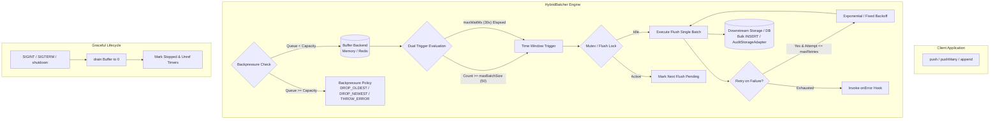

# @kido/batch-buffer

> **High-Performance Hybrid Buffer & Flush Engine**: Size + Time Window Dual Trigger, Mutex Concurrency Locks, Backpressure Guards, Distributed Redis Driver, and Read-Your-Own-Writes Audit Trail Adapter.

---

## 📌 Architecture Overview



---

## 🚀 Key Features

1. **Optimal Hybrid Dual Trigger (Size + Time Window)**:
   - **Size Trigger (`maxBatchSize: 50`)**: When 50 items accumulate, triggers an immediate bulk flush (e.g. SQL bulk INSERT).
   - **Time Window Trigger (`maxWaitMs: 30,000ms`)**: During off-peak or idle periods, flushes remaining items every 30s to 1m, preventing stale audit logs without overloading CPUs with 5s thrashing.
   - **Anti-Thrashing Timer Rescheduling**: Automatically resets and aligns the time window after each size-triggered flush.

2. **Concurrency Mutex & Flush Lock**:
   - Strictly ensures **zero concurrent executions** of the downstream flusher for the same batcher instance.
   - Eliminates duplicate entries and race conditions during high-volume spikes.

3. **Multi-Policy Backpressure Guard**:
   - `DROP_OLDEST`: Evicts oldest records from the head to guarantee real-time telemetry during DB write lockouts.
   - `DROP_NEWEST`: Drops new incoming writes while retaining historical items.
   - `THROW_ERROR`: Rejects requests immediately with `BatchBufferOverflowError` to push backpressure to HTTP callers.

4. **Graceful Drain & Zero Data Loss**:
   - Intercepts `SIGINT` / `SIGTERM` signals (when enabled) to drain all pending in-memory logs before process termination.
   - Supports timeout protection (`shutdownTimeoutMs`).

5. **Pluggable Drivers & Distributed Redis/Valkey Support**:
   - `MemoryBackend`: Zero-dependency amortized $O(1)$ FIFO queue with automatic head compaction.
   - `RedisBackend`: Distributed Redis/Valkey List driver with atomic Lua script batch popping (`LRANGE` + `LTRIM`).
   - `MockRedisClient`: Built-in Redis mock for testing without external services.

6. **Micro-Batching Audit Trail Adapter (`@kido/audit-trail`)**:
   - `BufferedAuditStorageAdapter`: Wraps sequential `AuditStorageAdapter` instances.
   - **Read-Your-Own-Writes**: Combines persisted DB records with pending in-memory buffer records during `getAll()` and `getById()`, delivering instant query visibility.

---

## 📦 Installation

```bash
# In pnpm workspace
pnpm add @kido/batch-buffer
```

---

## 🛠️ Quick Start

### Basic HybridBatcher Usage

```typescript
import { HybridBatcher } from '@kido/batch-buffer';

interface OrderLog {
  orderId: string;
  amount: number;
}

const batcher = new HybridBatcher<OrderLog>({
  maxBatchSize: 50,     // Flush every 50 items
  maxWaitMs: 30000,     // Or at least every 30 seconds
  maxQueueCapacity: 10000,
  backpressurePolicy: 'DROP_OLDEST',
  flusher: async (batch) => {
    // Bulk INSERT to database
    await db.orderLogs.insertMany(batch);
  },
  onFlush: (batch, metrics) => {
    console.log(`Flushed ${batch.length} items. Total: ${metrics.flushedItemsCount}`);
  },
});

// Push single or multiple items
await batcher.push({ orderId: 'ORD_001', amount: 150000 });
await batcher.pushMany([
  { orderId: 'ORD_002', amount: 320000 },
  { orderId: 'ORD_003', amount: 50000 },
]);

// Graceful shutdown on server stop
await batcher.shutdown();
```

---

### Buffered Audit Trail Adapter Integration

```typescript
import { MemoryStorageAdapter } from '@kido/audit-trail';
import { BufferedAuditStorageAdapter } from '@kido/batch-buffer';

const persistentDbAdapter = new MemoryStorageAdapter();

const bufferedAdapter = new BufferedAuditStorageAdapter(persistentDbAdapter, {
  maxBatchSize: 50,
  maxWaitMs: 30000,
});

// Appending is non-blocking and batched
await bufferedAdapter.append(auditEntry);

// Immediately visible even before flushed to database!
const allEntries = await bufferedAdapter.getAll();
const entry = await bufferedAdapter.getById(auditEntry.id);
```

---

## 📊 Telemetry Metrics

```typescript
const metrics = batcher.getMetrics();

console.log({
  flushedBatchesCount: metrics.flushedBatchesCount,
  flushedItemsCount: metrics.flushedItemsCount,
  droppedItemsCount: metrics.droppedItemsCount,
  errorCount: metrics.errorCount,
  currentQueueSize: metrics.currentQueueSize,
  lastFlushDurationMs: metrics.lastFlushDurationMs,
});
```

---

## 🧪 Testing

```bash
# Run comprehensive unit test suite
pnpm --filter @kido/batch-buffer test

# Build dual ESM/CJS bundles & DTS
pnpm --filter @kido/batch-buffer build
```
