# @kido/event-marketing

> **Event Lifecycle Drip Engine, Post-Event ROI Telemetry & Multi-Channel Notification Dispatcher**  
> Engine tự động hóa tiếp thị vòng đời sự kiện (Event Lifecycle Drip) và đo lường chỉ số ROI truyền thông sau sự kiện (Post-Event ROI Telemetry) cho các đơn vị tổ chức sự kiện, truyền thông doanh nghiệp và dịch vụ photobooth cao cấp.

---

## 🏛️ 3-Tier Progressive Scale Architecture (`Naive Baseline` → `Tier-0 SME Zero-Infra` → `Tier-1 Growth` → `Tier-2 Big-Tech`)

| Cấp Độ (Tier) | Kiến Trúc & Cơ Chế (Architecture & Mechanism) | Chi Phí & Vận Hành (Cost & Ops) | Hiệu Năng & SLA (Performance / SLA) | Khuyến Nghị Sử Dụng (When to Use) |
| :--- | :--- | :--- | :--- | :--- |
| **Naive Baseline** | **Manual Reminders / Unindexed Cron Polling**: Nhân viên gửi tin nhắn thủ công qua Zalo/Email, hoặc viết script cron chạy `SELECT * FROM events WHERE trigger_date <= NOW()` mỗi phút; gửi email đồng bộ trực tiếp qua SMTP. | $0 phụ trội | • **~5 - 10 msgs/s**<br>• Dễ bị trùng tin nhắn khi cron bị timeout hoặc chạy đè | 🛑 **Bỏ lỡ "thời điểm vàng"**: Nhắc báo giá bỏ dở bị trễ quá 2 tiếng làm mất khách; gửi trùng email báo cáo làm phiền Giám đốc Marketing (CMO) nhãn hàng. |
| **Tier-0 SME Zero-Infra** | **In-Memory Pure State Machine + Craft Minimalist HTML Builder + Direct SDKs**: Máy trạng thái thuần túy tính toán mốc giờ vàng (`EventLifecycleDripEngine`), render email HTML chuẩn Stripe/Linear (<1ms), dispatch trực tiếp qua Zalo ZNS / Telegram Bot / Resend API. | **$5/mo** (Single VPS 1-2GB RAM, Node / Bun) | • **1,000+ rules/s**<br>• Latency: **< 0.1ms rule evaluation**<br>• Zero external queue | ✅ **Chuẩn mặc định cho Agency sự kiện, Studio cưới, Photobooth cao cấp** (10 - 50 sự kiện/tháng, $0 chi phí hạ tầng hàng đợi). |
| **Tier-1 Growth** | **PostgreSQL Event Store + Redis BullMQ Delayed Jobs + Anti-Duplicate Mutex**: Đặt lịch tin nhắn vào hàng đợi trễ Redis BullMQ (`{ delay: triggerTime - now }`), khóa chống gửi trùng (`SETNX drip_lock:<event>:<rule>`), cập nhật trạng thái đã gửi vào PostgreSQL. | **$30 - $60/mo** (Managed PostgreSQL + Redis 7) | • **10,000+ scheduled drips/ngày**<br>• Jitter độ trễ: **< 5s**<br>• 100% Zero-Duplicate | ⭐ **Khuyến nghị cho đơn vị tổ chức 100 - 500 sự kiện/tháng, quản lý đồng thời hàng chục ekip chụp/quay tại nhiều sảnh tiệc**. |
| **Tier-2 Big-Tech** | **Distributed Event-Driven Orchestrator + Kafka Stream + Omnichannel Multi-Tier Fallback Cascade**: Điều phối đa kênh tự động (Zalo ZNS → SMS Brandname → Email → App Push) khi kênh trước đó thất bại sau 30 giây; đẩy số liệu telemetry vào ClickHouse sinh dashboard tài trợ thời gian thực. | **$150 - $400/mo** (Kafka + ClickHouse + Multi-Channel SMS Gateway) | • **100,000+ msgs/phút burst**<br>• SLA: **99.999% Delivery Tracking**<br>• Realtime Sponsor Dashboard | 🚀 **Chuẩn Big-Tech (Lễ hội âm nhạc quốc tế, Mega Expo, Hội nghị công nghệ toàn cầu)** với hàng chục nghìn khách tham dự đồng thời. |

---

## 📐 Sơ Đồ Tiến Hóa Kiến Trúc (Mermaid Evolution Diagram)

```mermaid
flowchart TD
    subgraph S0["Naive Baseline (Polling & Spam Risk)"]
        N_Cron["Cron Job (Every 1 min)"] -->|Heavy Polling Query| N_DB[("Database\n(No Indexes on Trigger Dates)")]
        N_DB -->|Timeout overlap: 2 workers run simultaneously| N_Dup["DUPLICATE EMAIL SENT!\nKhách VIP nhận 2 lần thông báo"]
    end

    subgraph S1["Tier-0 SME Zero-Infra ($5/mo Single VPS)"]
        T0_Event["Event Scheduled"] --> T0_Engine["@kido/event-marketing\n(EventLifecycleDripEngine)"]
        T0_Engine --> T0_Rules["Golden Timing Triggers:\nT-24h (Briefing) | T+2h (Quote Nudge)\nT+24h (B2B ROI) | T+3d (Gallery) | T+365d (Anniversary)"]
        T0_Rules --> T0_Direct["Direct SDK Dispatch\n(Telegram Bot / Zalo ZNS / Resend API)"]
    end

    subgraph S2["Tier-1 Growth ($30 - $60/mo Redis + Postgres HA)"]
        T1_Event["Multi-Venue Events"] --> T1_DB[("PostgreSQL Master\n(Event Lifecycle Records)")]
        T1_DB --> T1_BullMQ["Redis BullMQ Delayed Jobs\n(Exact-millisecond trigger execution)"]
        T1_BullMQ --> T1_Lock["Anti-Duplicate Redis Mutex\n(SETNX drip_lock:evt_101:roi_report)"]
        T1_Lock --> T1_Dispatch["Multi-Worker Dispatch Service"]
    end

    subgraph S3["Tier-2 Big-Tech Production (Omnichannel Festival Scale)"]
        T2_Guest["100,000 Attendees"] --> T2_Kafka["Kafka Event Stream\n(events.attendee.interaction)"]
        T2_Kafka --> T2_Cascade["Omnichannel Fallback Cascade\n(Zalo ZNS ➔ SMS Brandname ➔ Email ➔ Push)"]
        T2_Kafka --> T2_ClickHouse[("ClickHouse Analytics\n(Realtime Cost Per Impression & Viral Reach)")]
        T2_ClickHouse --> T2_Sponsor["Live Sponsor ROI Executive Dashboard"]
    end
```



---

## 💻 Mã Nguồn Thực Thi: Tier-0 SME vs Tier-2 Big-Tech

### 1. Tier-0 SME Mode: Golden Trigger Scheduling & Minimalist ROI Email Generation

Vận hành trực tiếp trong backend Node/Bun của studio/agency, tự động sinh lịch gửi tin và tính toán telemetry cho nhà tài trợ:

```typescript
import {
  EventLifecycleDripEngine,
  calculateEventRoiTelemetry,
  renderB2bRoiEmail,
  TelegramAdapter,
  ZaloZnsAdapter,
  EventDetails,
} from '@kido/event-marketing';

// 1. Khởi tạo động cơ vòng đời sự kiện
const dripEngine = new EventLifecycleDripEngine();

const summitEvent: EventDetails = {
  id: 'evt_tech_gala_2026',
  name: 'Vietnam AI & Cloud Summit 2026',
  category: 'B2B_CORPORATE',
  clientName: 'Anh Trần Minh Quân',
  clientEmail: 'quan.tm@enterprise.vn',
  eventDate: new Date('2026-12-15T18:00:00.000Z'),
};

// 2. Tự động sinh lịch trình gửi thông điệp theo các mốc vàng (T-24h, T+24h...)
const schedule = dripEngine.generateSchedule(summitEvent);
console.log('Tổng số tin nhắn lên lịch:', schedule.length);

// 3. Tính toán báo cáo ROI Telemetry sau sự kiện
const roiMetrics = calculateEventRoiTelemetry({
  eventCost: 25_000_000,          // Chi phí gói quay chụp/photobooth: 25 triệu VND
  totalSessions: 600,             // 600 lượt trải nghiệm
  totalPhotosPrinted: 1_200,      // 1,200 ảnh in nhiệt K80 lấy liền
  qrScans: 850,                   // 850 lượt quét QR tải video 4K
  leadsCaptured: 520,             // 520 khách VIP để lại số điện thoại/email
  estimatedAttendance: 1_500,     // 1,500 khách tham dự
  avgSocialSharesPerGuest: 2.2,   // 2.2 lượt chia sẻ Story/Reels
  avgFollowersPerGuest: 400,      // Trung bình 400 followers/khách
});

console.log('Chi phí trên mỗi lượt tiếp cận (CPI):', `${roiMetrics.costPerImpressionVnd.toFixed(2)} VND`);
console.log('Đánh giá hiệu quả ngân sách:', roiMetrics.cpiRating); // 'EXCELLENT' (< 100 VND)

// 4. Sinh mã HTML Email Craft Minimalism trang trọng gửi Giám đốc Marketing
const emailHtml = renderB2bRoiEmail({
  clientName: summitEvent.clientName,
  eventName: summitEvent.name,
  roi: roiMetrics,
  ctaUrl: 'https://media-hub.example.com/reports/tech-gala-2026',
});

// 5. Gửi thông báo tóm tắt điều phối ekip sự kiện qua Telegram Bot
const telegram = new TelegramAdapter({ botToken: process.env.TELEGRAM_BOT_TOKEN! });
const briefingMarkdown = telegram.formatCrewBriefingMarkdown(summitEvent);
await telegram.sendMessage('@event_crew_ops', briefingMarkdown);
```

---

### 2. Tier-2 Big-Tech Mode: BullMQ Scheduled Jobs with Omnichannel Fallback Cascade

Dành cho quy mô hàng trăm sự kiện lớn mỗi tuần với cơ chế tự động chuyển kênh khi khách chưa đọc tin:

```typescript
import {
  EventLifecycleDripEngine,
  calculateEventRoiTelemetry,
  EventDetails,
} from '@kido/event-marketing';

export class BigTechEventMarketingOrchestrator {
  constructor(
    private readonly bullMqQueue: any,
    private readonly redisClient: any,
    private readonly multiChannelGateway: any
  ) {}

  /**
   * Lên lịch hàng đợi trễ chính xác tới từng mili-giây cho tất cả trigger của sự kiện
   */
  async scheduleEventDrips(event: EventDetails) {
    const engine = new EventLifecycleDripEngine();
    const scheduledRules = engine.generateSchedule(event);

    for (const item of scheduledRules) {
      const delayMs = Math.max(0, item.scheduledAt.getTime() - Date.now());

      await this.bullMqQueue.add(
        'DISPATCH_EVENT_DRIP',
        {
          eventId: event.id,
          ruleId: item.ruleId,
          channel: item.channel,
          recipientEmail: event.clientEmail,
          recipientPhone: event.clientPhone,
          scheduledAt: item.scheduledAt.toISOString(),
        },
        {
          delay: delayMs,
          jobId: `drip:${event.id}:${item.ruleId}`,
          removeOnComplete: true,
          attempts: 3,
          backoff: { type: 'exponential', delay: 5000 },
        }
      );
    }
  }

  /**
   * Worker xử lý: Gửi tin với Cascade Fallback (Zalo ZNS -> SMS Brandname nếu Zalo chưa nhận)
   */
  async executeDripWorker(jobData: any) {
    const lockKey = `drip_lock:${jobData.eventId}:${jobData.ruleId}`;
    const acquired = await this.redisClient.set(lockKey, 'LOCKED', 'NX', 'EX', 3600); // Khóa 1 giờ

    if (!acquired) {
      console.warn('Job already executed or in progress, skipping duplicate.');
      return;
    }

    // 1. Ưu tiên gửi Zalo ZNS (Chi phí rẻ, thương hiệu uy tín)
    const znsResult = await this.multiChannelGateway.sendZaloZns(jobData.recipientPhone, jobData.payload);

    if (!znsResult.success) {
      // 2. Tự động fallback sang SMS Brandname viễn thông nếu tài khoản Zalo không nhận được
      await this.multiChannelGateway.sendSmsBrandname(jobData.recipientPhone, jobData.smsFallbackText);
    }
  }
}
```

---

## 🌟 Các Tính Năng Nổi Bật

1. **Trigger Thời Điểm Vàng (Golden Timing Rules)**:
   - `T-24h (Briefing Ekip)`: Tự động nhắc nhở call time, địa điểm, checklist thiết bị qua Telegram/Email.
   - `T+2h (Cứu Báo Giá Bỏ Dở)`: Gửi Zalo ZNS nhắc khách chưa chốt hợp đồng, đính kèm video hậu trường các show lớn.
   - `T+24h (B2B ROI Telemetry)`: Bắn báo cáo hiệu quả truyền thông & đo lường điểm chạm cho CMO nhãn hàng.
   - `T+3d (B2C Tiệc Cưới)`: Gửi email link Cloud Gallery tải ảnh & video 4K chất lượng cao kèm mã PIN bảo mật.
   - `T+365d (Kỷ Niệm Cưới)`: Chúc mừng 1 năm ngày cưới kèm voucher ưu đãi chụp ảnh gia đình.

2. **Báo Cáo ROI Telemetry Đo Lường Điểm Chạm (`calculateEventRoiTelemetry`)**:
   - Tính toán chi phí trên mỗi lượt hiển thị (CPI - Cost Per Impression) so sánh với benchmark quảng cáo số (Facebook/Google Ads ~200 - 300 VND/impression).
   - Đo lường độ lan tỏa mạng xã hội (Estimated Viral Social Reach) dựa trên hành vi đăng Story của khách VIP.
   - Đánh giá xếp hạng hiệu quả: `EXCELLENT` (< 100 VND), `GOOD` (100 - 250 VND), `MODERATE` (250 - 500 VND), `EXPENSIVE` (> 500 VND).

3. **Email Builder Chuẩn Craft Minimalism**:
   - Thiết kế tối giản, sang trọng chuẩn Stripe & Linear style, tương thích hoàn hảo trên mọi ứng dụng email di động (iOS Mail, Gmail, Outlook).
   - Tự động tích hợp bảng telemetry tương tác và nút CTA mở báo cáo chi tiết.

4. **Bộ Adapters Đa Kênh Tích Hợp Sẵn**:
   - `ZaloZnsAdapter`: Chuẩn hóa số điện thoại Việt Nam và gửi tin nhắn thông báo thương hiệu Zalo ZNS.
   - `TelegramAdapter`: Định dạng Markdown chuyên nghiệp gửi thông tin điều phối nội bộ cho ekip.
   - `EmailAdapter`: Tích hợp linh hoạt với Resend, SendGrid hoặc Mock adapter cho môi trường development.

---

## 📦 Cài Đặt

```bash
pnpm add @kido/event-marketing
```

---

## 🧪 Kiểm Thử

```bash
pnpm test
```
Toàn bộ 18 test cases được kiểm thử qua native `node:test` và `node:assert/strict`.
