# @kido/gemini-cookie-sync

> **Automated Auth Session Cookie Extractor, Chrome Extension Sync Bridge & Rotating Token Pool Combo**  
> Hệ thống trích xuất cookie phiên xác thực Google Gemini tự động qua Chrome Extension Manifest V3, cơ chế đồng bộ biến môi trường không làm gián đoạn tiến trình (Hot-Reloading), middleware bắt lỗi 401 tự động phục hồi phiên, và tạo file nén ZIP tiện ích mở rộng chuẩn CRC32 zero-dependency.

---

## 🏛️ 3-Tier Progressive Scale Architecture (`Naive Baseline` → `Tier-0 SME Zero-Infra` → `Tier-1 Growth` → `Tier-2 Big-Tech`)

| Cấp Độ (Tier) | Kiến Trúc & Cơ Chế (Architecture & Mechanism) | Chi Phí & Hạ Tầng (Cost & Ops) | Hiệu Năng & SLA (Performance / SLA) | Khuyến Nghị Khi Nào Dùng (When to Use) |
| :--- | :--- | :---: | :---: | :--- |
| **Naive Baseline** | **Static Hardcoded Cookies in `.env`**: Copy thủ công cookie từ DevTools dán vào file `.env`; cookie hết hạn sau 12 - 24 giờ khiến các pipeline AI tự động gãy vụn giữa đêm; lập trình viên phải thức dậy đăng nhập lại và restart container. | $0 extra | • Sập pipeline sau 12h<br>• Lộ secret trong git commit<br>• Manual restart downtime | 🛑 **Chỉ dùng cho thử nghiệm cục bộ trong 1 buổi làm việc** |
| **Tier-0 SME Zero-Infra** | **Chrome Extension Bridge + Zero-Dependency Zip & Hot Env Sync** (`createHonoCookieSyncMiddleware`, `extractCookiesFromHeader`, `syncCookiesToEnvironment`, `createExtensionZipBuffer`): Tiện ích mở rộng Manifest V3 tự động gửi cookie mới khi người dùng mở trình duyệt; server Node/Bun cập nhật trực tiếp `process.env` mà không cần khởi động lại tiến trình; $0 chi phí hạ tầng. | **$5/mo** (Single VPS / Dev Machine) | • **Latency: < 0.1ms**<br>• **Zero Restart Downtime**<br>• Zero external dependency | ✅ **Chuẩn mặc định cho cá nhân, solopreneur, bot AI nội bộ, server dev** |
| **Tier-1 Growth** | **AES-256-GCM Encrypted Secret Vault + Proactive Session Health Check Worker**: Cookie được mã hóa lưu trong cơ sở dữ liệu an toàn; cron worker nền kiểm tra tính tươi mới của phiên định kỳ mỗi giờ; tự động gửi cảnh báo Telegram / Webhook trước khi cookie hết hạn 2 tiếng. | **$25 - $50/mo** (Single VPS + DB) | • Latency: 1 - 5ms<br>• Throughput: 1,000 req/s<br>• Proactive Expiry Warnings | ⭐ **Khuyến nghị cho ứng dụng AI phục vụ khách hàng, đại lý tư vấn AI tự động** |
| **Tier-2 Big-Tech** | **Distributed Multi-Account Rotating Pool + Headless Browser Refresh Farm**: Cụm tài khoản Gemini xoay vòng (Round-Robin / Least-Loaded) phân phối hạn mức API; worker chạy trình duyệt không đầu (Playwright / Puppeteer) trên container độc lập tự động gia hạn phiên; phân phối token qua Valkey cluster với cơ chế failover tức thì khi gặp lỗi 429 hoặc 401. | **$120 - $350/mo** (Worker Pool + Valkey) | • 99.99% High Availability<br>• Multi-Account Load Balancing<br>• Infinite Quota Multiplier | 🚀 **Chuẩn Big-Tech cho nền tảng tổng hợp dữ liệu AI, crawl bài nghiên cứu quy mô triệu requests** |

---

## 📐 Kiến Trúc Luồng Dữ Liệu (Mermaid Diagram)

```mermaid
flowchart TD
    subgraph S0["Naive Baseline (Sập Pipeline Lúc Nửa Đêm)"]
        N_Env[".env Static Hardcoded Cookie"] -->|Hết Hạn Sau 12 Giờ| N_Err["HTTP 401 Unauthorized Crash!"]
        N_Err -->|Cần Dev Thức Dậy Dán Lại| N_Manual["Mất Toàn Bộ Dữ Liệu Đang Xử Lý"]
    end

    subgraph S1["Tier-0 SME Zero-Infra ($5/mo Single VPS / Local Dev)"]
        T0_Browser["Chrome Browser (User Active)"] -->|Manifest V3 Background| T0_Ext["Gemini Cookie Sync Extension"]
        T0_Ext -->|HTTP POST Header| T0_Server["createHonoCookieSyncMiddleware"]
        T0_Server --> T0_Hot["syncCookiesToEnvironment (Hot-Reload RAM)"]
        T0_Hot --> T0_AI["AI Pipelines Run Uninterrupted"]
    end

    subgraph S2["Tier-1 Growth (Encrypted Token Vault & Health Prober)"]
        T1_Vault[("AES-256-GCM Secret Vault")] --> T1_Probe["Hourly Session Health Check Worker"]
        T1_Probe -->|Phát Hiện Sắp Hết Hạn| T1_Alert["Bắn Cảnh Báo Telegram / Webhook"]
    end

    subgraph S3["Tier-2 Big-Tech (Multi-Account Rotating Farm)"]
        T2_Pool["Multi-Account Worker Pool"] --> T2_Valkey[("Distributed Valkey Token Store")]
        T2_Valkey -->|429 / 401 Instant Failover| T2_Router["Round-Robin Account Load Balancer"]
        T2_Router --> T2_Headless["Headless Browser Auto-Refresh Farm"]
    end
```



---

## 🚀 Hướng Dẫn Sử Dụng Chi Tiết Theo Từng Tier

### 1. Tier-0 SME Zero-Infra Mode
Tích hợp middleware nhận cookie tự động cho server Hono / Node.js và nạp trực tiếp vào môi trường:

```typescript
import {
  createHonoCookieSyncMiddleware,
  extractCookiesFromHeader,
  syncCookiesToEnvironment,
  createExtensionZipBuffer,
} from "@kido/gemini-cookie-sync";
import { Hono } from "hono";

const app = new Hono();

// 1. Tự động trích xuất cookie từ header do Chrome Extension gửi lên
app.use("*", createHonoCookieSyncMiddleware({
  targetEnv: process.env,
  onSyncSuccess: (keys) => {
    console.log(`Đã đồng bộ ${keys.length} cookies mới vào môi trường:`, keys);
  },
}));

// 2. Endpoint cho phép người dùng tải tiện ích Chrome Extension đã đóng gói ZIP
app.get("/api/download-extension", (c) => {
  const zipBuffer = createExtensionZipBuffer();
  return c.body(zipBuffer, 200, {
    "Content-Type": "application/zip",
    "Content-Disposition": 'attachment; filename="gemini-cookie-sync.zip"',
  });
});
```

### 2. Tier-2 Big-Tech Mode (Tự Động Phục Hồi Phiên & Interceptor Client)
Interceptor phía trình duyệt tự động bắt lỗi 401 và kích hoạt tiện ích cập nhật cookie trong suốt với người dùng:

```typescript
import {
  setupFetchInterceptor,
  isAuthOrCookieExpiredError,
  requestCookieSyncFromExtension,
} from "@kido/gemini-cookie-sync";

// Thiết lập fetch interceptor trên frontend ứng dụng
const restoreOriginalFetch = setupFetchInterceptor({
  onAuthExpired: async () => {
    console.warn("Phiên Gemini hết hạn. Đang yêu cầu extension đồng bộ cookie mới...");
    const freshCookies = await requestCookieSyncFromExtension();
    return freshCookies !== null;
  },
});
```

---

## 📦 Cài Đặt

```bash
pnpm add @kido/gemini-cookie-sync
```

## 🧪 Kiểm Thử

```bash
bun test packages/gemini-cookie-sync
```
