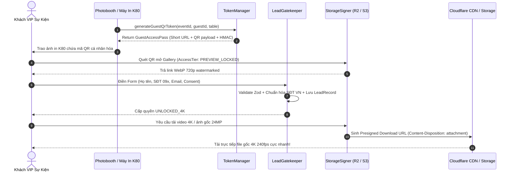

# @kido/instant-gallery

> **Live Cloud Gallery & Viral Lead Magnet Gateway** chuyên biệt cho Glambot 360, Photobooth chụp lấy liền và các sự kiện VIP 500 – 2,000 khách (T-RED Media `tred.vn` & T-RED Photobooth `fotobooth.vn`).

---

## 🌟 Bối Cảnh & Vấn Đề Giải Quyết

Tại mỗi sự kiện Gala doanh nghiệp, tiệc cưới, ra mắt xe hơi hay lễ hội âm nhạc, 500 – 2,000 khách VIP trải nghiệm Glambot 360 độ hoặc Photobooth in ảnh luôn muốn nhận video/ảnh ngay lập tức:
- ❌ **Cách truyền thống**: AirDrop nghẽn băng thông, Google Drive lộn xộn tìm rất lâu, gửi Zalo/Telegram bị nén vỡ hình, không thu được data khách hàng.
- ✅ **Giải pháp @kido/instant-gallery**:
  1. Máy in K80 in mã QR cá nhân hóa lên chân ảnh nhiệt (`tr.vn/g/v7_xyz123?sig=...&src=k80_print`).
  2. Khách quét QR mở ngay Live Web Gallery cá nhân trên điện thoại xem preview 720p có dán mờ Watermark & banner nhà tài trợ.
  3. Khách nhập Họ tên, SĐT di động Việt Nam, Email và đồng ý nhận thông tin sự kiện để mở khóa tải trực tiếp **Video 4K 240fps** hoặc **Ảnh gốc 24MP**.
  4. T-RED Media thu thập **100% Data Khách VIP tự nguyện, sạch chuẩn**, sẵn sàng đẩy sang CRM hoặc automation drip marketing.

---

## 🏗️ Kiến Trúc Hệ Thống (Mermaid Diagram)



---

## 📦 Cài Đặt

```bash
pnpm add @kido/instant-gallery zod
```

---

## 🚀 Hướng Dẫn Sử Dụng Chi Tiết

### 1. Sinh Mã QR Truy Cập Rút Gọn In Lên Chân Ảnh K80 (`TokenManager`)

```typescript
import { generateGuestQrToken, TokenManager } from '@kido/instant-gallery';

// Sinh mã QR cá nhân hóa cho bàn tiệc hoặc khách VIP
const pass = generateGuestQrToken('evt_vinfast_2026', 'guest_vip_007', 'Bàn 08', {
  shortUrlPrefix: 'https://tr.vn/g',
  ttlSeconds: 7 * 24 * 3600, // Hiệu lực 7 ngày
});

console.log(pass.fullShortUrl); // https://tr.vn/g/v7_a8b9c0d1
console.log(pass.qrPayload);    // https://tr.vn/g/v7_a8b9c0d1?sig=f83e...&src=k80_print
```

### 2. Xác Thực Mã & Chống Brute Force (`TokenManager` + `RateLimiter`)

```typescript
const manager = new TokenManager({
  secretKey: process.env.GALLERY_HMAC_SECRET,
  maxVerificationAttempts: 5,
  blockDurationMs: 300_000, // Khóa 5 phút nếu brute-force sai
});

const verify = manager.verifyPass(pass, {
  clientIdentifier: req.ip,
  signature: req.query.sig,
});

if (!verify.isValid) {
  return res.status(403).json({ error: verify.error });
}
```

### 3. Phễu Thu Lead & Mở Quyền Tải 4K (`LeadGatekeeper`)

```typescript
import { captureLead, validateVietnamPhone } from '@kido/instant-gallery';

// Kiểm tra số điện thoại Việt Nam chuẩn 10 số (đầu 03, 05, 07, 08, 09)
const phoneCheck = validateVietnamPhone('+84 98 123 4567');
console.log(phoneCheck.normalized); // '0981234567'

// Xử lý submit form từ khách
const result = await captureLead(pass, {
  fullName: 'Phạm Minh Khang',
  phoneNumber: '0912.345.678',
  email: 'khang.pham@vinfast.vn',
  company: 'VinFast Auto',
  jobTitle: 'Giám Đốc Marketing',
  consentMarketing: true,
}, {
  clientIp: req.ip,
  userAgent: req.headers['user-agent'],
  unlockedMediaIds: ['media_glambot_001'],
  onLeadCaptured: async (lead) => {
    // Tích hợp đẩy sang CRM hoặc gửi thông báo Telegram
    console.log('Thu thập Lead VIP thành công:', lead.id);
  },
});

if (result.success) {
  console.log('Pass đã được nâng lên:', result.accessTier); // 'UNLOCKED_4K'
}
```

### 4. Ký Presigned URL Tải 4K hoặc Xem Preview (`StorageSigner`)

```typescript
import { generateDownloadUrl, UnauthorizedTierError } from '@kido/instant-gallery';

// Khi chưa mở khóa -> chỉ trả link WebP 720p dán mờ watermark
const preview = generateDownloadUrl(mediaItem, pass); // pass.accessTier === 'PREVIEW_LOCKED'
console.log(preview.url); // Trả link xem preview có watermark

// Nếu khách cố tình request tải 4K khi chưa điền thông tin -> Bị chặn ngay lập tức
try {
  generateDownloadUrl(mediaItem, pass, { requestedTier: 'UNLOCKED_4K' });
} catch (err) {
  if (err instanceof UnauthorizedTierError) {
    console.warn(err.message); // "Khách chưa mở khóa quyền tải file 4K..."
  }
}

// Khi khách đã submit thành công -> Tải trực tiếp file gốc MP4 4K 240fps
const raw4k = generateDownloadUrl(mediaItem, result.updatedPass);
console.log(raw4k.url);           // Link CDN R2 ký HMAC có hiệu lực 1 giờ
console.log(raw4k.contentType);   // 'video/mp4'
console.log(raw4k.isWatermarked); // false
```

### 5. Dán Khung Branded Overlay & Watermark (`WatermarkEngine`)

```typescript
import { generateOverlaySvgTemplate, WatermarkEngine } from '@kido/instant-gallery';

// Tính toán safe zones tránh bị che bởi UI của TikTok / Instagram Reels
const safeZones = WatermarkEngine.calculateSafeZones('9:16', { width: 1080, height: 1920 });

// Sinh template SVG khung thương hiệu nhãn hàng hoặc Monogram tiệc cưới
const svgFrame = generateOverlaySvgTemplate({
  eventName: 'VinFast VF9 VIP Gala Launch',
  sponsorName: 'T-RED Media & fotobooth.vn',
  eventDate: '10.10.2026',
  previewMode: true, // Thêm stamp "PREVIEW WATERMARK - SCAN QR ON K80"
});
```

### 6. Tối Ưu Chia Sẻ Story 9:16 & OpenGraph Cards (`generateSocialSharePayload`)

```typescript
import {
  generateSocialSharePayload,
  generateOpenGraphMetaTags,
} from '@kido/instant-gallery';

const shareData = generateSocialSharePayload(mediaItem, eventConfig, pass, {
  customHashtags: ['#GlambotDaNang', '#VinFastVIP'],
});

console.log(shareData.platformTargets.TIKTOK.shareUrl);
console.log(shareData.platformTargets.FACEBOOK_STORY.shareUrl);
console.log(shareData.platformTargets.ZALO.shareUrl);

// Xuất thẻ Meta HTML cho trang xem gallery cá nhân
const htmlMetaTags = generateOpenGraphMetaTags(shareData);
```

---

## 🧪 Kiểm Thử

Toàn bộ 12 test cases được viết trên chuẩn native `node:test` và `node:assert/strict`:

```bash
pnpm test
```

Build thư viện hỗ trợ đầy đủ ESM (`dist/index.mjs`), CJS (`dist/index.js`), và TypeScript Declarations (`dist/index.d.ts`):

```bash
pnpm run build
```
