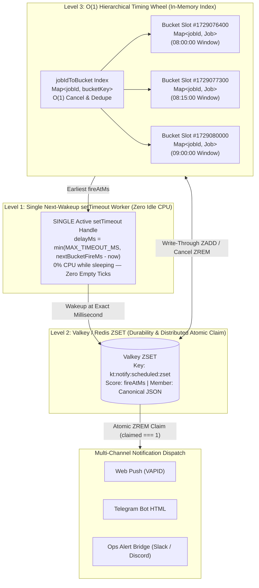
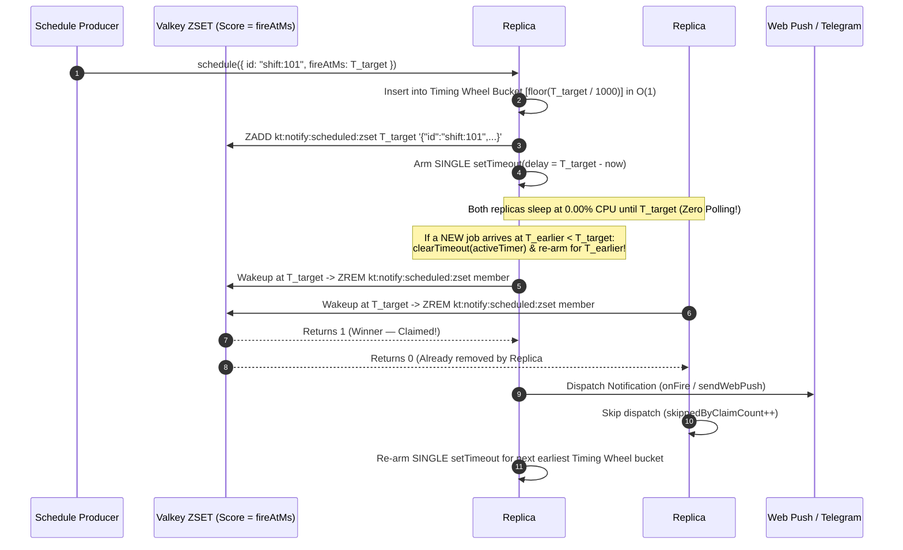

# `@kido/notify` — Multi-Channel Notification & Big-Tech Hybrid Timing Wheel Scheduler

Unified notification engine for **Web Push (VAPID)**, **Telegram Bot HTML Notifications**, **Ops Alert Webhook Bridge** (Prometheus / Alertmanager / SigNoz / Uptime Kuma ➔ Telegram / Discord / Slack), and a **Big-Tech 3-Layer Hybrid Notification Scheduler** (**Hierarchical Timing Wheel + Valkey/Redis `ZSET` + Single Next-Wakeup `setTimeout` Worker**).

---

## 🏛️ Evolutionary Architecture: Notification Scheduling at Scale

How does a high-scale backend schedule and fire delayed notifications (e.g., 15-minute shift check-in reminders, flash-sale countdown alerts, appointment reminders, SLA escalations) across thousands of tenants without burning idle CPU, blowing up V8 heap memory, or firing duplicate pushes across container replicas?

### Comparative Architecture Matrix (Level 1 ➔ Level 6)

| Level / Architecture | Insertion & Cancel Complexity | Memory Overhead (100k Jobs) | Idle CPU Overhead | Crash Durability | Multi-Replica Safe (Zero Duplicates) | Production Verdict |
| :--- | :--- | :--- | :--- | :--- | :--- | :--- |
| **1. Naive DB Polling** (`setInterval` every 1s–60s running `SELECT ... WHERE fire_at <= NOW()`) | $O(\log N)$ B-Tree insert, $O(N)$ table scan if unindexed | Low in-app, high DB buffer churn | **High** (720–86,400 wasted DB queries/day even when 0 jobs exist) | ✅ Yes (PostgreSQL) | ⚠️ Requires `FOR UPDATE SKIP LOCKED` | ❌ Avoid: Constant DB IOPS & CPU burn during idle hours |
| **2. Naive $N \times$ `setTimeout`** (One native JS `setTimeout` per scheduled job) | $O(1)$ insert, $O(1)$ `clearTimeout` | **Very High** (~200–400 bytes per V8 `Timeout` object + libuv timer tree) | Low when idle, high GC pressure at scale | ❌ **None** (100% lost on container restart/deploy) | ❌ **No** (Every replica fires duplicates) | ❌ Avoid: V8 heap bloat & 32-bit overflow (`> 24.8 days` fires immediately!) |
| **3. Single-Timer + Min-Heap Priority Queue** (Go `time.Timer`, Java `ScheduledThreadPoolExecutor`) | $O(\log N)$ push/pop, **$O(N)$ or $O(\log N)$ cancel** | Low (1 native `setTimeout` + array heap) | **0% Idle CPU** (sleeps until heap root `peek().fireAtMs`) | ❌ None in-memory | ❌ No across replicas | ⚠️ Good for single-node, but lacks $O(1)$ cancellation & crash recovery |
| **4. Distributed Valkey / Redis `ZSET` Delay Queue** (`ZADD` score=`fireAtMs`, `ZRANGEBYSCORE` + `ZREM`) | $O(\log N)$ SkipList + HashTable in Valkey | Minimal in-app (offloaded to Valkey RAM) | Medium if polling Valkey every 1s | ✅ **Yes** (Valkey AOF/RDB persistence) | ✅ **Yes** (Atomic `ZREM` returns `1` to winner, `0` to others) | ✅ Industry standard for distributed queues (Sidekiq / BullMQ) |
| **5. Hierarchical Timing Wheel** (Kafka `Purga­tory` / Netty `HashedWheelTimer`) | **$O(1)$ insert, $O(1)$ cancel, $O(1)$ bucket lookup** | Low (`Map<bucketSlot, Map<jobId, Job>>`) | Classic wheel ticks every slot ($O(1)$ empty ticks) | ❌ In-memory only unless backed by WAL | ❌ Single-process by default | ⚡ Best-in-class $O(1)$ throughput for massive timer churn |
| **6. Hybrid Timing Wheel + Valkey `ZSET` + Single Next-Wakeup `setTimeout` (`@kido/notify`)** | **$O(1)$ bucket insert, $O(1)$ cancel (`jobIdToBucket`), $O(1)$ batch slot flush** | **Ultra-Low** (**EXACTLY ONE** `setTimeout` handle for 1 or 1,000,000 jobs) | **0.00% Idle CPU** ("Zero Empty Tick" jump directly to earliest bucket) | ✅ **Yes** (Valkey `ZSET` write-through + `hydrateFromZSet()`) | ✅ **Yes** (Lock-free atomic `ZREM` claim guarantees 0 duplicates) | 🏆 **Recommended Big-Tech Standard** |

---

## 📐 3-Layer Hybrid Scheduler Architecture (`HybridNotificationScheduler`)



### Multi-Replica Atomic Claim Sequence (100% Zero Duplicate Notifications)



---

## 🚀 Quick Start & Usage Examples

### 1. Hybrid Timing Wheel + Valkey `ZSET` Notification Scheduler

```ts
import {
  createNotificationScheduler,
  createValkeyZSetAdapter,
  sendWebPush,
} from '@kido/notify';
import Redis from 'ioredis';

const valkey = new Redis(process.env.REDIS_URL!);

const scheduler = createNotificationScheduler<{
  title: string;
  body: string;
  subscription: { endpoint: string; keys: { p256dh: string; auth: string } };
}>({
  bucketResolutionMs: 1_000, // 1-second O(1) Timing Wheel buckets
  zsetStore: createValkeyZSetAdapter(valkey),
  zsetKey: 'acme:notify:scheduled:zset',
  onFire: async (job) => {
    await sendWebPush(job.payload.subscription, {
      title: job.payload.title,
      body: job.payload.body,
    }, {
      subject: 'mailto:ops@khanhdp.com',
      publicKey: process.env.VAPID_PUBLIC_KEY!,
      privateKey: process.env.VAPID_PRIVATE_KEY!,
    });
  },
});

// Hydrate any pending jobs from Valkey ZSET on container startup
await scheduler.hydrateFromZSet();

// Schedule a shift reminder 15 minutes before shift start (O(1) bucket insert + single timer arm)
await scheduler.schedule({
  id: 'shift-reminder:shift_99:user_42',
  fireAtMs: Date.now() + 15 * 60 * 1_000,
  tenantId: 'acme-hq',
  userId: 'user_42',
  payload: {
    title: '⏰ Sắp vào ca sáng (08:00)',
    body: 'Còn 15 phút nữa bắt đầu ca làm việc tại cửa hàng.',
    subscription: userPushSubscription,
  },
});

// Cancel in O(1) if the shift is deleted or staff already checked in early
await scheduler.cancel('shift-reminder:shift_99:user_42');

// Inspect live Zero-Idle-CPU telemetry
console.log(scheduler.getTelemetry());
/*
{
  activeTimerArmed: false,
  nextWakeupAt: null,
  nextWakeupMs: null,
  lastScheduledDelayMs: null,
  timerReArmCount: 1,
  totalPendingJobs: 0,
  totalBuckets: 0,
  firedCount: 0,
  claimedCount: 0,
  skippedByClaimCount: 0,
  cancelledCount: 1,
  mode: 'HYBRID_TIMING_WHEEL_ZSET_SINGLE_TIMER'
}
*/
```

### 2. Web Push (VAPID) Notifications with Auto-Expiry Detection

```ts
import { createWebPushNotifier, generateVAPIDKeys } from '@kido/notify';

const vapidKeys = generateVAPIDKeys();
const webPush = createWebPushNotifier({
  subject: 'mailto:admin@khanhdp.com',
  publicKey: vapidKeys.publicKey,
  privateKey: vapidKeys.privateKey,
});

const result = await webPush.send(subscription, {
  title: '✅ Check-in thành công!',
  body: 'Bạn đã chấm công vào ca lúc 07:55.',
  url: '/attendance',
});

if (result.isExpired) {
  // Automatically clean up HTTP 404 / 410 Gone subscriptions from DB
}
```

### 3. Telegram Bot HTML Notifications & E-Commerce / Spa / Villa Formatters

```ts
import { createTelegramNotifier } from '@kido/notify';

const telegram = createTelegramNotifier({
  botToken: process.env.TELEGRAM_BOT_TOKEN!,
  defaultChatId: process.env.TELEGRAM_CHAT_ID!,
});

await telegram.notifyOrder({
  orderId: 'ORD-2026-889',
  customerName: 'Nguyễn Văn A',
  phone: '0901234567',
  items: [{ name: 'Combo Burger Phô Mai', quantity: 2, price: 85000 }],
  totalAmount: 170000,
  paymentMethod: 'VIETQR',
  paymentStatus: 'PAID',
});
```

### 4. Ops Alert Webhook Bridge (Prometheus / SigNoz / Uptime Kuma ➔ Telegram / Discord / Slack)

```ts
import { createAlertBridgeWebhookHandler } from '@kido/notify';

const handler = createAlertBridgeWebhookHandler({
  secretToken: process.env.WEBHOOK_SECRET,
  telegram: {
    botToken: process.env.TELEGRAM_BOT_TOKEN!,
    chatId: process.env.TELEGRAM_OPS_CHAT_ID!,
  },
});
```

---

## 🧪 Running Tests & Building

```bash
# Run unit tests (Formatters, WebPush, Ops Alert Bridge, and Hybrid Timing Wheel Scheduler)
npm test

# Typecheck & bundle CJS + ESM + DTS
npm run typecheck
npm run build
```
