# @kido/offline-sync

> **Offline-First Synchronization, Litestream PITR & Partition Lifecycle Suite**  
> RFC 9562 Monotonic UUIDv7 Generator, Local Outbox Sync Engine, Offline POS Store with K80 Receipt & VietQR Deposit, Litestream SQLite WAL Point-In-Time-Recovery (PITR), PostgreSQL Logical Replication LSN Health Monitor, Advisory-Locked TimescaleDB CAGG Refresher, and Zero-Lock Cold Partition Archiver.

---

## 🏛️ 3-Tier Progressive Scale Architecture (`Naive Baseline` → `Tier-0 SME Zero-Infra` → `Tier-1 Growth` → `Tier-2 Big-Tech`)

| Tier | Architecture & Storage | Cost & Ops | Throughput & Latency | When to Use |
| :--- | :--- | :--- | :--- | :--- |
| **Naive Baseline** | **Direct Synchronous Cloud DB**: Client requests block waiting for remote database. Fails immediately on network outage. | $0 extra | 50–100 req/s<br>Latency: 80–500ms network RTT | 🛑 **Toy / Lab only**: Total application freeze or crash whenever network connection drops or fluctuates. |
| **Tier-0 SME Zero-Infra** | **Local SQLite WAL + UUIDv7 Outbox + Litestream PITR continuous streaming to S3/R2** (`uuidv7`, `OutboxQueue`, `OfflinePOSStore`, `LitestreamPitrEngine`) | **$5/mo**<br>(Single Linux VPS / Tablet) | **1,500 local ops/s**<br>Latency: 0ms offline execution | ✅ **Default for SMEs, POS & Storefronts**: Zero external DB servers required. Operates 100% offline with zero data loss. Litestream streams WAL frames to Cloudflare R2 / S3 for continuous point-in-time recovery. |
| **Tier-1 Growth** | **PostgreSQL Logical Replication & LSN Lag Monitor + Advisory-Locked CAGG Refresher** (`evaluateLogicalReplicationHealth`, `AdvisoryLockedViewRefresher`, `ConflictResolver`) | **$50–$150/mo**<br>(Primary + Read Replicas) | **15,000 ops/s**<br>Replication lag: < 1s | ⭐ **Growing Multi-Branch Retail / SaaS**: PostgreSQL Primary with read replicas, automatic LSN lag monitoring, non-overlapping advisory-locked materialized view refreshes, and Vector Clock conflict resolution. |
| **Tier-2 Big-Tech** | **Declarative Range Sub-Partitioning + Zero-Lock Cold S3/R2 Partition Archiver** (`planMonthlyPartitions`, `buildDetachPartitionSql`, `ColdTierPartitionArchiver`, TimescaleDB policies) | **$200–$500+/mo**<br>(Multi-Cluster Storage) | **Hundreds of Millions of Rows**<br>Pruned query: < 2ms | 🚀 **Big-Tech Enterprise**: Declarative table partitioning with zero-lock `CONCURRENTLY` partition detaching, compressing historical chunks to ndjson.gz with SHA-256 parity verification, and offloading to cold S3/R2 storage. |

---

## 📐 Evolutionary Scale Architecture (Mermaid Diagram)

```mermaid
flowchart TD
    subgraph Naive["Naive Baseline (Synchronous Remote DB)"]
        N_POS["Cashier / Mobile App"] -->|Sync HTTP Call| N_Cloud[("Cloud Database")]
        N_Cloud -.->|WiFi Cut / Outage| N_Fail["Application Freeze / Lost Customer Order"]
    end

    subgraph Tier0["Tier-0 SME Zero-Infra ($5/mo Single VPS / Edge POS)"]
        T0_POS["Offline POS Store"] -->|UUIDv7 Monotonic ID| T0_Local[("Local SQLite WAL Database\n(Instant K80 Receipt & VietQR)")]
        T0_Local -->|Background Sync when Online| T0_Sync["OutboxQueue & SyncEngine\n(Batch push to remote API)"]
        T0_Local -->|Continuous WAL Frames| T0_Lite["Litestream PITR Engine\n(Continuous replication to Cloudflare R2)"]
    end

    subgraph Tier1["Tier-1 Growth (PostgreSQL Cluster)"]
        T1_Primary[("PostgreSQL Master")] -->|Logical Replication| T1_Replica[("Read Replicas")]
        T1_Mon["evaluateLogicalReplicationHealth\n(Monitors byte lag & worker status)"] --> T1_Primary
        T1_Ref["AdvisoryLockedViewRefresher\n(Coordinates Timescale CAGG refreshes)"] --> T1_Replica
    end

    subgraph Tier2["Tier-2 Big-Tech (Cold Storage Offload)"]
        T2_PG[("PostgreSQL Range Partitions")] -->|Zero-Lock Detach CONCURRENTLY| T2_Detach["Detached Monthly Partition"]
        T2_Detach --> T2_Comp["ColdTierPartitionArchiver\n(Gzip ndjson + SHA-256 Parity Verification)"]
        T2_Comp --> T2_S3[("Cold S3 / Cloudflare R2 Storage\n(Zero Disk Bloat & Sub-2ms Pruned Queries)")]
    end
```



---

## 🚀 Concrete Implementation Examples

### 1. Tier-0 SME Mode (Zero External Infra — $5/mo VPS or Offline POS)
Operates 100% offline with local SQLite WAL, RFC 9562 UUIDv7 ordering, and continuous Litestream backup to Cloudflare R2:

```typescript
import {
  uuidv7,
  OfflinePOSStore,
  OutboxQueue,
  LitestreamPitrEngine,
} from '@kido/offline-sync';

// 1. Monotonic time-ordered IDs generated offline without collisions
const orderId = uuidv7();

// 2. Initialize offline POS store (instant order creation & K80 receipt printing)
const pos = new OfflinePOSStore({
  storeId: 'store_danang_01',
  posTerminalId: 'pos_counter_1',
});

// Create order offline with stock check & K80 formatted text receipt
const orderResult = pos.createOrderOffline({
  orderId,
  customerPhone: '0901234567',
  items: [
    { itemId: 'coffee_beans_250g', name: 'Arabica Da Lat', quantity: 2, unitPrice: 120000 },
  ],
  paymentMethod: 'CASH',
});

console.log(orderResult.receiptK80Text);

// 3. Litestream PITR: Continuous SQLite WAL replication to Cloudflare R2
const pitr = new LitestreamPitrEngine({
  dbPath: './data/pos_store.db',
  replicaBucket: 'pos-wal-backups',
  endpoint: 'https://<account-id>.r2.cloudflarestorage.com',
  accessKeyId: process.env.R2_ACCESS_KEY_ID!,
  secretAccessKey: process.env.R2_SECRET_ACCESS_KEY!,
});

// Generates valid litestream.yml configuration automatically
const configYaml = pitr.generateLitestreamConfig();
```

---

### 2. Tier-2 Big-Tech Mode (Zero-Lock Partition Detaching & Cold S3/R2 Archiver)
Detaches historical monthly partitions from active PostgreSQL tables without blocking writes, verifies data integrity with SHA-256 checksums, and offloads to cold storage:

```typescript
import {
  ColdTierPartitionArchiver,
  buildDetachPartitionSql,
  planMonthlyPartitions,
  type ColdStorageAdapter,
} from '@kido/offline-sync';

// 1. Generate non-locking partition detachment SQL
const detachSql = buildDetachPartitionSql({
  parentTable: 'store_orders',
  partitionTable: 'store_orders_y2025m12',
  concurrently: true, // Uses DETACH PARTITION ... CONCURRENTLY (Zero Write Locks)
});

// 2. Cold-tier archiver configuration
const s3ColdStorage: ColdStorageAdapter = {
  putObject: async ({ key, buffer, sha256Hex }) => {
    // Stream gzip buffer to S3 / Cloudflare R2
    await s3Client.upload({ Bucket: 'archive-ledger', Key: key, Body: buffer });
    return { key, sha256Hex, byteLength: buffer.length };
  },
};

const archiver = new ColdTierPartitionArchiver({
  storageAdapter: s3ColdStorage,
  batchSize: 5_000,
  maxAllowedRowDrift: 0, // Strict zero data loss invariant
});

// 3. Execute zero-loss archival workflow
const archiveResult = await archiver.archivePartition({
  parentTable: 'store_orders',
  partitionTable: 'store_orders_y2025m12',
  queryRowsBatch: async (offset, limit) => {
    return await db.query(
      `SELECT * FROM store_orders_y2025m12 ORDER BY created_at ASC OFFSET $1 LIMIT $2`,
      [offset, limit]
    );
  },
  dropPartitionAfterArchive: true, // Safely drops table ONLY after SHA-256 check matches!
});

console.log(
  `Archived ${archiveResult.archivedRowCount} rows to ${archiveResult.manifestKey} (Gzip: ${archiveResult.compressedByteLength} bytes)`
);
```

---

## 📦 Features Breakdown

1. **RFC 9562 UUIDv7**: Lexicographically sortable 128-bit identifiers with sub-millisecond precision, optimal for database B-Tree index locality.
2. **Offline Outbox & Conflict Resolution**: Last-Write-Wins (LWW), Vector Clocks, and Append-Only financial compensation models.
3. **Litestream PITR Engine**: Continuous microsecond WAL frame streaming from SQLite to S3/R2, enabling recovery to any exact millisecond.
4. **PostgreSQL Replication Health**: Real-time evaluation of byte lag, worker state, and active replication slots.
5. **AdvisoryLockedViewRefresher**: Uses PostgreSQL session-level advisory locks to ensure scheduled TimescaleDB continuous aggregate and materialized view refreshes never collide.
6. **ColdTierPartitionArchiver**: Safely detaches and moves historical data to cold storage with SHA-256 checksum validation and zero read/write table locks.
