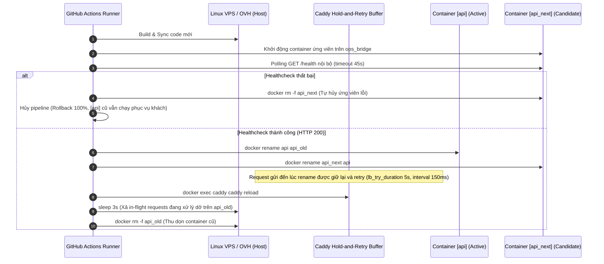

# @kido/zero-downtime-deploy

> **Universal Zero-Downtime Deployment Toolkit (Package #31)**  
> Cung cấp cơ chế triển khai Blue-Green Atomic Swap 100% Zero-Downtime cho cả Fullstack Backend (Docker/Bun/Node), Frontend (Vite/React/Nginx/Caddy), và Caddy Edge Reverse Proxy Hold-and-Retry Buffer trên hạ tầng Linux VPS / OVH / Cloudflare.

---

## 🏛️ Bảng Tiến Hóa Kiến Trúc (Sơ Khởi ➔ Điểm Nghẽn ➔ Chuẩn Big Tech)

| Cấp Độ (Level) | Kiến Trúc & Giải Pháp | Ưu Điểm (Pros) | Điểm Nghẽn & Rủi Ro (Failure Modes) | Tiêu Hao RAM & Độ Phức Tạp | Trạng Thái / Đánh Giá |
| :--- | :--- | :--- | :--- | :--- | :--- |
| **Level 1 (Sơ khởi)** | **Docker Recreate** (`docker rm -f` / `docker compose up --force-recreate`) | Đơn giản, không cần cấu hình proxy. | • **Downtime 2–5s**: Mọi request trong lúc container khởi động đều nhận mã **HTTP 502 Bad Gateway**.<br>• **Không có auto-rollback**: Container mới crash khiến toàn bộ dịch vụ sập hoàn toàn. | RAM: 1x<br>Độ phức tạp: Cực thấp | ❌ **Nghiêm cấm trong Production** |
| **Level 2 (Điểm nghẽn 1 — ĐÃ LOẠI BỎ)** | **Multi-Replica Rolling Update via Caddy** (`rolling-update-caddy.sh`) | Caddy tự động phát hiện instance chết để ngắt upstream; luôn có ít nhất 1 instance online. | • **Lãng phí RAM 24/7**: Cần duy trì tối thiểu 2 container chạy liên tục (ngốn gấp đôi RAM trên VPS 4–8GB).<br>• **Mixed-Version Split-Brain**: Phiên bản `v1` và `v2` cùng chạy song song làm lệch schema DB và cache.<br>• Trễ healthcheck 2s của Caddy vẫn có thể làm rơi request. | RAM: **2x liên tục (Lãng phí)**<br>Độ phức tạp: Trung bình | 🛑 **Đã loại bỏ & Thu hồi** (`rolling-update-caddy.sh` removed) |
| **Level 3 (Điểm nghẽn 2)** | **Blue-Green `docker rename` thuần túy** | • Tiết kiệm RAM: Chỉ chạy 1 container 24/7, chỉ tốn gấp đôi RAM trong ~10s khi warm-up.<br>• 100% Auto-rollback an toàn nếu ứng viên lỗi. | • **Khe hở 10–50ms**: Trong tích tắc Docker daemon rename và bridge DNS cập nhật IP mới, các request gửi đến đúng khoảnh khắc này bị `502 Connection Refused`. | RAM: 1x thường trực (2x trong 10s)<br>Độ phức tạp: Thấp | ⚠️ **Chưa hoàn hảo** (Vẫn có thể xuất hiện micro-drop 502) |
| **Level 4 (Chuẩn Big Tech Single-Node & Edge)** | **Blue-Green Pre-Warm Swap + Caddy Hold-and-Retry Buffer (`lb_try_duration 5s`, `lb_try_interval 150ms`) + Edge WAF Next-Action Guard** | • **0ms Downtime Tuyệt Đối**: Caddy giữ kết nối client và tự động retry upstream trong 5s; khe hở 10-50ms lúc swap được đệm hoàn toàn.<br>• **Zero Memory Bloat 24/7**: Chỉ chạy 1 container chính, container cũ được drain 3s rồi dọn sạch.<br>• **Edge WAF Protection**: Chặn đứng scanner probes (`Next-Action`) ở tầng Caddy với HTTP 403. | Vẫn phụ thuộc vào việc reverse proxy retry khi network DNS chuyển giao. | RAM: 1x thường trực (2x trong ~10s)<br>Độ phức tạp: Trung bình | ✅ **Chuẩn Baseline** |
| **Level 5, 6 & 7 (Chuẩn Big Tech Enterprise Full-Combo)** | **Zero-Gap Network-Alias Swap (Tier-5) + Read-Only Shadow Parity Diff & JIT Warm-up (Tier-6) + Canary Bake & Error Gate (Tier-7)** | • **0.00ms DNS Gap (Tier-5)**: Gắn `--alias <active>` trên `ops_bridge` cho candidate trước khi ngắt v1, DNS không mất bản ghi dù 1 microsecond.<br>• **Shadow Parity & JIT Warm-up (Tier-6)**: 5 probes song song `X-Shadow-Probe: 1` kiểm tra schema mismatch & làm nóng V8/Bun JIT, connection pool DB.<br>• **Canary Bake & Error Gate (Tier-7)**: Chia tải thật trong 10s, quét log phát hiện panic/uncaughtException/50x tự động rollback 100%. | Đòi hỏi script điều phối Docker network và engine quét error signatures chuẩn xác. | RAM: **1x thường trực** (2x trong ~10s)<br>Độ phức tạp: Đã đóng gói tự động hóa 100% | ⭐ **Chuẩn Production Bắt Buộc (Mặc định toàn hệ thống)** |

---

## 💡 Các Trụ Cột Kỹ Thuật Độc Quyền Trong `@kido/zero-downtime-deploy`

### 1. Inode Atomic Directory Swap cho Frontend (< 1ms)
- Quá trình deploy build static web ở runner GitHub Actions, sau đó sync toàn bộ file vào thư mục staging `apps/<app>_next`.
- Khi sync hoàn tất 100%, thực hiện hoán đổi nguyên tử thông qua lệnh kernel `mv`:
  ```bash
  mv /opt/kido-infra/docker/portfolio/html/apps/<app> /opt/kido-infra/docker/portfolio/html/apps/<app>_backup
  mv /opt/kido-infra/docker/portfolio/html/apps/<app>_next /opt/kido-infra/docker/portfolio/html/apps/<app>
  rm -rf /opt/kido-infra/docker/portfolio/html/apps/<app>_backup
  ```
- **Nguyên lý OS**: Trên hệ thống tệp Linux (ext4/NVMe), lệnh `mv` giữa hai thư mục trên cùng một mount point là thao tác cập nhật con trỏ inode của nhân hệ điều hành diễn ra trong **dưới 1 millisecond** (< 1ms). Web server (Nginx/Caddy) không bao giờ nhìn thấy trạng thái thư mục rỗng hoặc file chưa ghi xong.

### 2. Blue-Green Pre-Warm Container Swap cho Backend API (0ms Downtime)
Quy trình hoán đổi container động theo chuẩn 6 bước:


### 3. Caddy Zero-Downtime Proxy Buffer Snippet (`generateCaddyZeroDowntimeSnippet`)
Sinh cấu hình Caddyfile cho khối `reverse_proxy` để đệm kết nối TCP khi container đang đổi tên:

```typescript
import { generateCaddyZeroDowntimeSnippet } from '@kido/zero-downtime-deploy';

const snippet = generateCaddyZeroDowntimeSnippet({
  tryDuration: '5s',
  tryInterval: '150ms',
  includeOldFallback: false,
});
console.log(snippet);
```
Kết quả sinh ra:
```caddy
(zero_downtime_proxy) {
	lb_try_duration 5s
	lb_try_interval 150ms
}
```

### 4. Next.js Server Action Edge WAF Guard (`generateCaddyNextJsActionGuardSnippet`)
Sinh bộ lọc RE2 Caddy matcher chặn đứng các bot scanner gửi header `Next-Action` độc hại hoặc payload SSRF (CVE-2024-34351) ngay tại Edge proxy:

```typescript
import { generateCaddyNextJsActionGuardSnippet } from '@kido/zero-downtime-deploy';

const guardSnippet = generateCaddyNextJsActionGuardSnippet();
console.log(guardSnippet);
```
Kết quả sinh ra (tương thích RE2 Go regex, không dùng negative lookahead):
```caddy
(nextjs_action_guard) {
	@invalid_next_action {
		header Next-Action *
		not header_regexp Next-Action ^[0-9a-fA-F]{40,42}$
	}
	respond @invalid_next_action "Forbidden: Invalid Server Action" 403
}
```

### 5. Inode-Safe Caddy Reload (`buildInodeSafeCaddyReloadCmd`)
Giải quyết triệt để vấn đề Linux VFS single-file bind-mount inode detachment (khi `git reset --hard` hoặc `sed -i` làm thay đổi inode trên host nhưng container Caddy vẫn giữ inode cũ bị unlink):
```typescript
import { buildInodeSafeCaddyReloadCmd } from '@kido/zero-downtime-deploy';

const cmd = buildInodeSafeCaddyReloadCmd({
  hostCaddyfilePath: '/opt/kido-infra/caddy/Caddyfile',
  containerName: 'caddy',
});
// docker cp "/opt/kido-infra/caddy/Caddyfile" "caddy:/tmp/Caddyfile" && docker exec "caddy" caddy validate --config "/tmp/Caddyfile" --adapter caddyfile && docker exec "caddy" caddy reload --config "/tmp/Caddyfile" --adapter caddyfile
```

### 6. Graceful Shutdown & Connection Draining Controller (`setupGracefulShutdown`)
Đảm bảo khi ứng dụng nhận tín hiệu tắt (`SIGTERM`, `SIGINT`), toàn bộ request in-flight được xử lý xong và tài nguyên được giải phóng hoàn toàn:
- Đóng kết nối idle HTTP keep-alive (`closeIdleConnections`).
- Dừng nhận kết nối mới và drain các HTTP in-flight requests (`server.close()`).
- Thực thi hook dọn dẹp tài nguyên (ngắt kết nối Prisma DB, Redis cache, Message Queue, v.v.) qua `onShutdown`.
- Ngăn ngừa tình trạng double-execution khi nhận nhiều tín hiệu tắt liên tiếp.
- Cơ chế Safety Timer (`timeout.unref()`) tự động ép tắt an toàn (`exit(1)`) nếu teardown bị treo quá `timeoutMs` (mặc định 10s).

```typescript
import { setupGracefulShutdown } from '@kido/zero-downtime-deploy';

const shutdownController = setupGracefulShutdown({
  server: () => httpServer,
  timeoutMs: 10000,
  signals: ['SIGTERM', 'SIGINT'],
  onShutdown: async (signal) => {
    await prisma.$disconnect();
    await redis.quit();
  },
  autoRegister: true,
});
```

### 7. Zero-Gap Network-Alias Control-Plane Swap (Tier-5)
Loại bỏ hoàn toàn khe hở 10–50ms khi rename container bằng cách gán alias của active container lên candidate trước khi ngắt container cũ:
```bash
docker network disconnect "ops_bridge" "$CANDIDATE_CONTAINER" 2>/dev/null || true
docker network connect --alias "$ACTIVE_CONTAINER" "ops_bridge" "$CANDIDATE_CONTAINER"
```
- Khi candidate đã mang `--alias "$ACTIVE_CONTAINER"`, Docker DNS nội bộ phân giải tên dịch vụ đồng thời về cả IP mới và cũ.
- Khi ngắt container cũ (`docker network disconnect ops_bridge "$ACTIVE_CONTAINER"`), toàn bộ traffic ngay lập tức trỏ 100% về container mới mà không mất một microsecond nào.

### 8. Read-Only Shadow Parity Diff & JIT Warm-up (Tier-6)
Kiểm tra tính tương thích ngược và làm nóng bộ nhớ đệm / JIT trước khi tiếp nhận lưu lượng người dùng:
```typescript
import { runShadowParityCheck } from '@kido/zero-downtime-deploy';

const parity = await runShadowParityCheck({
  baselineUrl: 'http://127.0.0.1:3000',
  candidateUrl: 'http://127.0.0.1:3002',
  paths: ['/health', '/api/ping'],
  probeCount: 5,
});

if (!parity.passed) {
  console.error('Shadow Parity Failed:', parity.reason);
}
```
- Gửi các request đồng thời kèm header `X-Shadow-Probe: 1` tới baseline và candidate.
- So sánh HTTP Status Code (2xx/3xx parity) và cấu trúc JSON Object Keys để bắt lỗi schema regression.
- Kích hoạt V8/Bun JIT compilation và khởi tạo sẵn PostgreSQL connection pool.

### 9. Canary Bake & Log Error Gate (Tier-7)
Mở cửa sổ Canary Bake thực tế (mặc định 10s) chia sẻ lưu lượng người dùng giữa v1 và v2, tự động quét và chặn đứng lỗi nghiêm trọng:
```typescript
import { buildShadowAndCanaryBashGate } from '@kido/zero-downtime-deploy';

const bashSnippet = buildShadowAndCanaryBashGate({
  activeContainer: 'flashbuy-api',
  internalPort: 3000,
  canarySeconds: 10,
  drainSeconds: 3,
});
```
- Trong cửa sổ Canary Bake, hệ thống giám sát log thời gian thực:
  `docker logs --since "10s" "$CANDIDATE_CONTAINER"`
- Bắt tức thì các chữ ký lỗi nghiêm trọng: `panic:`, `uncaughtException`, `unhandledRejection`, `PrismaClientInitializationError`, hoặc mã lỗi `"status":50[0-9]`.
- Khi phát hiện lỗi, script lập tức ngắt alias và gỡ bỏ candidate container (`docker rm -f`), khôi phục 100% lưu lượng về active container mà khách hàng không bị ảnh hưởng.

---

## 📦 Cấu Trúc Thư Mục Của Package

```
packages/zero-downtime-deploy/
├── package.json          # Name: "@kido/zero-downtime-deploy", Version: "1.0.0"
├── README.md             # Tài liệu chuẩn hóa kiến trúc Zero-Downtime
├── scripts/
│   ├── atomic-swap-be.sh # Script Blue-Green Container Swap cho Docker/Bun/Node
│   ├── atomic-swap-fe.sh # Script Inode Directory Swap cho Web Static / Nginx
│   └── health-check.sh   # Healthcheck probe có retry & auto rollback
├── workflows/
│   └── deploy.yml.template # Mẫu GitHub Actions workflow chuẩn
└── src/
    ├── index.ts          # Root exports & generator functions
    ├── graceful-shutdown.ts # Graceful shutdown & connection draining
    ├── caddy-reload/     # Caddy hold-and-retry snippet, Next.js action guard, inode-safe reload
    │   └── index.ts
    └── cli.ts            # CLI scaffolding tool
```

---

## 🚀 Hướng Dẫn Tích Hợp Vào Bất Kỳ Repo Nào Khi Tách Kho (Repo Detach Guide)

Khi tách một ứng dụng từ monorepo `monorepo-workspace` thành kho độc lập (như `order-api`, `app-web`, v.v.), hãy làm theo hướng dẫn dưới đây để có ngay CI/CD Zero-Downtime:

### Bước 1: Khởi Tạo Tự Động Bằng CLI

Trong thư mục gốc của repository mới, chạy lệnh:
```bash
npx @kido/zero-downtime-deploy init <tên-ứng-dụng> <url-healthcheck>
```
*Ví dụ:*
```bash
npx @kido/zero-downtime-deploy init order-api https://app.example.com/health
```
Lệnh trên sẽ tự động:
1. Tạo file `.github/workflows/deploy.yml` với cấu hình Blue-Green swap chuẩn.
2. Tạo thư mục `scripts/deploy/` chứa `atomic-swap-be.sh` và `atomic-swap-fe.sh`.

---

### Bước 2: Cấu Hình GitHub Secrets

Vào repository trên GitHub -> **Settings** -> **Secrets and variables** -> **Actions**, thêm 3 secrets:
- `SSH_PRIVATE_KEY`: Khóa SSH RSA/Ed25519 dùng để kết nối vào Linux VPS/OVH.
- `VPS_HOST`: Địa chỉ IP của VPS (ví dụ: `203.0.113.10` hoặc `203.0.113.20`).
- `SSH_USER`: Tên tài khoản SSH (mặc định: `root`).

---

### Bước 3: Cấu Hình Docker Compose Trên VPS

Đảm bảo file `docker/vps-docker-compose.yml` trên VPS sử dụng mạng chung `ops_bridge` để Caddy có thể reverse proxy:
```yaml
version: '3.8'

services:
  flashbuy-api:
    image: flashbuy-api:latest
    container_name: flashbuy-api
    restart: unless-stopped
    networks:
      - ops_bridge
    env_file:
      - .env
    volumes:
      - /opt/kido-infra/apps/flashbuy-api/dist:/app/dist:ro
      - /opt/kido-infra/data/flashbuy:/app/data

networks:
  ops_bridge:
    external: true
```

---

### Bước 4: Kiểm Thử Độc Lập

Chạy thử script kiểm tra sức khỏe hệ thống:
```bash
# Sử dụng CLI
npx @kido/zero-downtime-deploy check https://app.example.com/health 30

# Hoặc dùng script
./scripts/health-check.sh https://app.example.com/health 45 2 200 "status\":\"ok\""
```
